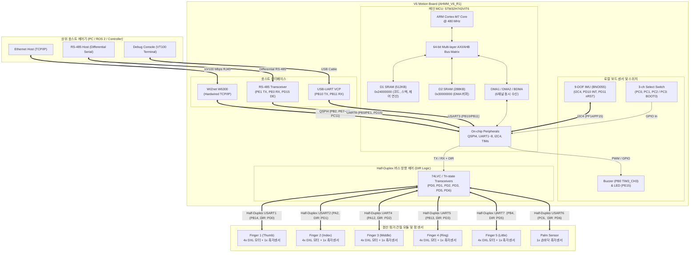
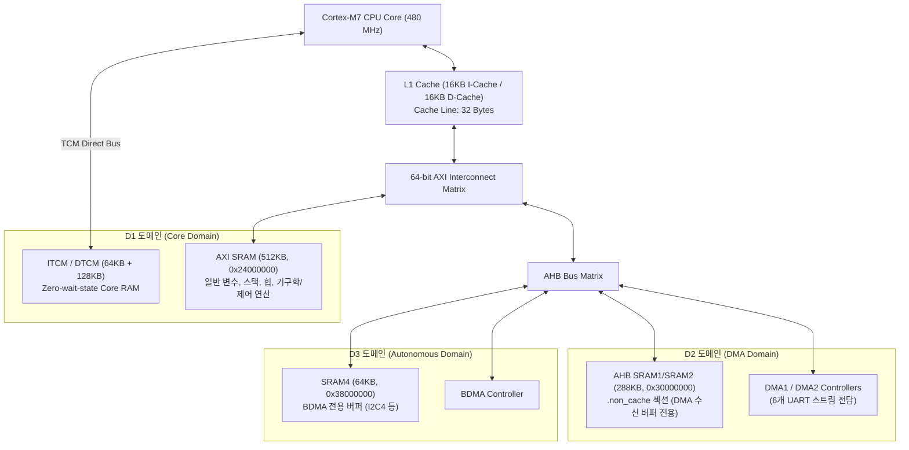
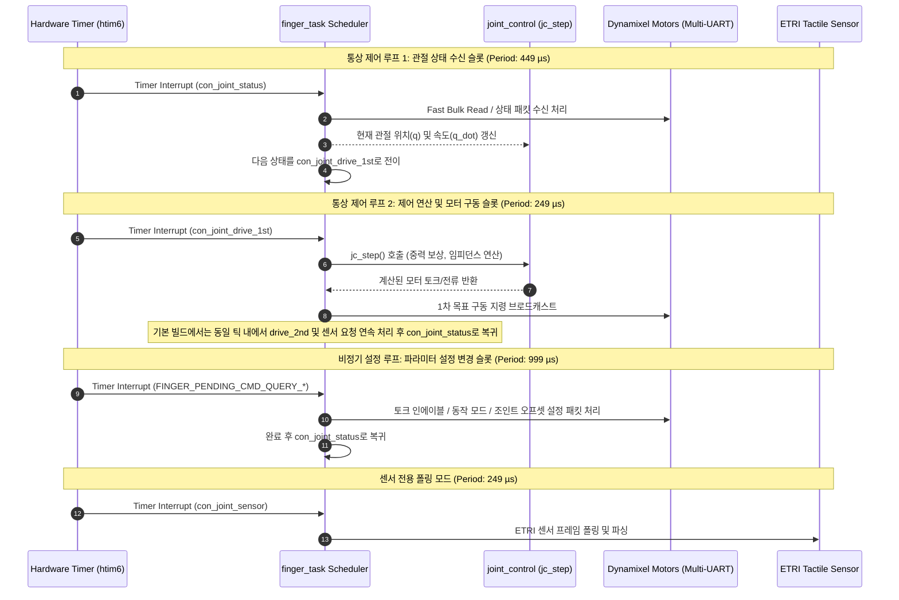

# V6 Motion Board 펌웨어 아키텍처 및 제어 시스템 분석

## 1. 개요 및 시스템 주요 제원

### ① 배경 및 목적
V6 모션 제어 보드(`AHMM_V6_R1`, `AHSB_V6_R1`, `AHDS_V6_R1`) 펌웨어는 4지/5지 다관절 로봇 핸드의 관절 제어 및 센서 인터페이스 처리를 위한 임베디드 소프트웨어이다.

STM32H743 MCU를 기반으로 손가락별 독립 Half-Duplex UART 5채널 및 손바닥 전용 UART 1채널을 배치하여 최대 20개 관절 모터와 촉각 센서를 구동하며, 중력 보상(RNEA) 및 Cartesian Tip 임피던스 제어 알고리즘을 단일 MCU 내에서 실행하도록 구성되어 있다.

본 문서는 V6 모션 보드 펌웨어의 버스 구조, 타이머 제어 주기, 기구학/제어 루프, 통신 인터페이스 및 Dual-Bank OTA 기능의 소스코드 구현 분석 내용을 기술한다.

### ② 시스템 제약 조건 및 설계 목표
1. **멀티채널 버스 구성**: 관절 액추에이터 및 센서 통신 지연을 줄이기 위해 손가락별 5개 독립 UART(4 Mbps)와 1개 팜 센서 UART(2 Mbps)를 병렬 운용하여 피드백 수신 시간을 단축한다.
2. **제어 추상화 계층**: 중력 보상, $H_\infty$ 강인 제어, Cartesian Tip 임피던스 제어 연산을 위해 `jc_platform.h` 인터페이스를 경유한다. (현재 구현에서는 타이머 인터럽트 서비스 루틴 내에서 동기 호출된다.)
3. **Flash Dual-Bank 펌웨어 갱신**: 업데이트 실패나 비정상 부팅 시 이전 정상 펌웨어로 복귀할 수 있도록 STM32H7 Dual-Bank 스왑 및 TRIAL 부팅 구조를 사용한다.

### ③ 시스템 주요 제원표

| 구분 | 주요 사양 | 세부 내용 및 1차 출처 검증 |
| :--- | :--- | :--- |
| **메인 MCU** | STM32H743VIT6 | ARM Cortex-M7 @ 480 MHz, Dual-Bank Flash 2MB, RAM 1MB |
| **L1 캐시** | 16 KB I-Cache + 16 KB D-Cache | 32바이트 라인 크기 (D-Cache 활성화) |
| **호스트 통신** | 10/100 Ethernet (WIZnet W6300) | QSPI4 고속 인터페이스 (PB2 CLK, PE7~10 D0~3, PC11 NCS) |
| | RS-485 (UART8) | 차동 직렬 버스 (PE1 TX, PE0 RX, PD15 DE), 최대 3 Mbps |
| | Debug VCP (USART3) | USB 가상 직렬 콘솔 (PB10 TX, PB11 RX), 115200 bps (VT100 CLI) |
| **핑거 모터 버스** | 5채널 Point-to-Point Half-Duplex UART | USART1, USART2, UART4, UART5, UART7 @ 4 Mbps |
| **센서 버스** | 핑거 센서: 모터 버스 공유 (Multi-Drop) | ETRI 3축 촉각 센서 (Dynamixel ID 14 에뮬레이션) |
| | 손바닥 센서: 전용 UART (USART6) | 팜 촉각 센서 독립 라인 (PC6, DIR: PD6) |
| | 자세 센서: 9-DOF IMU (BNO055) | I2C4 인터페이스 (PF14 SCL, PF15 SDA, PD10 INT1, PD11 nRST) |
| **하드웨어 제어** | DIP Switch (PC0, PC1, PC2, PC3) | R/L 기구학 선택, 통신 프로토콜(Modbus/Protobuf) 선택 |

---

## 2. 하드웨어 구조 및 내부 버스 연결

### ① 전체 시스템 하드웨어 블록 다이어그램
외부 호스트 제어기부터 STM32H7 MCU, 분산 직렬 버스, 최종 관절 액추에이터 및 센서까지의 전체 연결 토폴로지이다. (1차 출처 소스코드 `main.h`, `finger_channels` 실사 기준 반영)

### ② MCU 내부 버스 및 메모리 도메인
Cortex-M7 코어의 캐시 계층과 버스 매트릭스, 그리고 도메인별 메모리 배치를 나타낸다.

### ③ 메모리 맵 및 버스 매트릭스 동시성 메커니즘
- **메모리 영역 배치 규칙 (Linker Mapping)**:

| 메모리 영역 | 시작 주소 | 크기 | 용도 및 캐시 속성 | 할당 변수 및 버퍼 |
| :--- | :--- | :--- | :--- | :--- |
| **RAM_D1 (AXI)** | `0x24000000` | 512 KB | Normal, Cacheable | CPU 실행 스택, 힙, `joint_control` 연산, 전역 변수 |
| **RAM_D2 (AHB)** | `0x30000000` | 288 KB (MPU 설정: 256 KB) | Normal, Non-cacheable | `.non_cache` 섹션, 핑거 UART DMA 수신 버퍼 (`f_dma_rcv_buffer`) |
| **RAM_D3 (BDMA)** | `0x38000000` | 64 KB | Device / Non-cacheable | `.bdma_buf` 섹션, I2C4 BDMA 버퍼 |
- **버스 매트릭스 및 캐시 설정 특성**:
  - **CPU 독립성**: Cortex-M7 코어는 D1 SRAM(`0x24000000`)에서 순방향 기구학, 자코비안, 중력 보상 연산을 실행한다.
  - **DMA 독립성**: DMA1/DMA2 컨트롤러는 D2 도메인 버스(`0x30000000`)를 통해 6개 UART의 모터 응답 데이터를 메모리로 스트리밍한다.
  - AXI-to-AHB 브릿지를 통해 CPU 제어 연산과 주변장치 DMA 전송이 병렬 처리된다. 단, 실제 MPU Region 1 설정(`Core/Src/main.c`)은 256 KB로만 선언되어 있어 D2 최상위 32 KB(SRAM3: 0x30040000 ~ 0x30047FFF)가 MPU 선언에서 누락되어 있으며, 캐시 속성은 Normal Non-cacheable(`TEX=b001, C=0, B=0, S=1`)이 적용된다.

---

## 3. 핑거 버스 및 타이머 스케줄러

### ① 분산 멀티채널 핑거 버스 인터페이스 (`finger_dxl/`)
- **물리 계층**: Point-to-Point Half-Duplex Single-Wire UART (4,000,000 bps, 8-N-1).
- **실제 핀 매핑 (1차 출처: `Core/Inc/main.h`, `finger_bus_master.c`)**:

| 채널 | 대상 부위 | UART 페리페럴 | 신호 핀 (Half-Duplex) | 방향 제어 핀 (DIR) | 연결 장치 구성 |
| :--- | :--- | :--- | :--- | :--- | :--- |
| `FINGER_1` | Thumb (엄지) | **USART1** | `PB14` | `PD0` | DXL 관절 모터 4개 + 촉각 센서 1개 |
| `FINGER_2` | Index (검지) | **USART2** | `PA2` | `PD1` | DXL 관절 모터 4개 + 촉각 센서 1개 |
| `FINGER_3` | Middle (중지) | **UART4** | `PA12` | `PD2` | DXL 관절 모터 4개 + 촉각 센서 1개 |
| `FINGER_4` | Ring (약지) | **UART5** | `PB13` | `PD3` | DXL 관절 모터 4개 + 촉각 센서 1개 |
| `FINGER_5` | Little (소지) | **UART7** | `PB4` | `PD5` | DXL 관절 모터 4개 + 촉각 센서 1개 |
| `FINGER_P` | Palm (손바닥) | **USART6** | `PC6` | `PD6` | 팜 촉각 센서 1개 |
- **병렬 TDM 수신 타임슬롯 압축**:
  - 각 손가락 채널마다 4개의 Dynamixel 관절 모터(ID 1~4)와 1개의 촉각 센서(ID 14)가 Multi-Drop으로 연결된다.
  - 4 Mbps UART 기준 단일 손가락의 모터 4개 상태 패킷 수신에는 약 $390\,\mu\text{s}$가 소요된다. 본 시스템은 **5개 핑거 UART + 1개 팜 센서 UART 및 6개 DMA 스트림 병렬화**를 통해 20개 관절 전체의 수신을 **$449\,\mu\text{s}$ 단일 타임슬롯** 내에 병렬 처리한다.

### ② 핑거 제어 주기 및 상태 머신 동작
핑거 태스크(`finger_task.c`)는 단일 긴 루프를 돌지 않고, 마이크로초 단위의 가변 주기 하드웨어 기본 타이머(`TIM6`) 인터럽트를 통해 상태 머신으로 동작한다.

- **가변 주기 타이머 디스패처 (`f_task_periods[4]`) 실제 구현 매핑**:
  - `f_task_periods[0]` (**449 µs**): `con_joint_status` — 모터 관절 상태 피드백 수신 및 설정 변경 요청 대기열 검사.
  - `f_task_periods[1]` (**249 µs**): `con_joint_drive_1st` / `con_joint_drive_2nd` — 제어 알고리즘(`jc_step()`) 실행 및 관절 구동 패킷 브로드캐스트. 기본 빌드(`FINGER_DRIVE_TWICE` 미정의 시)에서는 1회 틱 내부에서 구동 명령 전송과 센서 요청이 연속 실행된 후 즉시 `con_joint_status`로 복귀한다.
  - `f_task_periods[2]` (**999 µs**): `req joint config` — 토크 인에이블(`TORQUE_ENABLED`), 동작 모드(`OPERATING_MODE`), 조인트 오프셋(`JOINT_OFFSET`) 등 모터 파라미터 변경 요청 시 할당되는 설정 전용 슬롯이다. (2차 구동 슬롯이 아님에 유의)
  - `f_task_periods[3]` (**249 µs**): `con_joint_sensor` — 핑거 팁 촉각 센서 전용 프레임 폴링 슬롯.

---

## 4. 관절 제어 알고리즘 구조

`control/` 모듈은 특정 모터 통신 방식과의 결합도를 낮추기 위해 `jc_platform.h` 추상화 포트를 경유한다. 다만 현재 구현에서는 `g_torque_enabled`, `g_right_left_sel` 등의 전역 플래그를 `extern`으로 직접 참조하며, 타이머 인터럽트 컨텍스트(`finger_task`) 내에서 물리 통신 전송 직전에 동기 실행된다.

### ① 해석적 중력 보상 엔진 (`gravity_comp.c`)
- `BNO055` IMU 센서로부터 손바닥의 3차원 자세 쿼터니언 및 중력 가속도 벡터를 실시간 취득한다.
- 링크 모델(`hand_model.c`)과 순방향 기구학(`hand_kin.c`)을 통해 각 관절이 중력에 대항해 정지 상태를 유지하는 데 필요한 보상 토크를 해석적으로 계산한다:
  $$\tau_{\text{grav}} = G(q, \mathbf{g}_{\text{imu}})$$
- 재귀 뉴턴-오일러 알고리즘(RNEA) 기반으로 링크별 관성 텐서와 질량 중심(COM) 위치를 반영하여 관절 토크를 실시간 보상한다.

### ② Cartesian Tip Impedance 제어기 (`impedance_ctrl.c`)
- 손끝(Tip) 위치에서 가상 스프링-댐퍼 시스템을 구현한다:
  $$\mathbf{f} = K \circ (x_d - x) + D \circ (\dot{x}_d - \dot{x})$$
- 기구학 자코비안 전치행렬($J^T$)을 곱해 관절 토크로 변환한다:
  $$\tau = G(q) + J^T \mathbf{f} - b \dot{q}$$
- 접촉 시 충격을 흡수하고 물체 표면 형상에 유연하게 순응(Compliance)하도록 지원한다.

### ③ $H_\infty$ 강인 제어기 (`hinf_ctrl.c`)
- 관절 외란 및 모델 불확실성에 대응하는 상태 피드백 제어를 제공하여 제어 안정성을 보장한다.

---

## 5. 호스트 통신 및 보드 설정

### ① 듀얼 호스트 통신 인터페이스

| 통신 채널 | 물리 인터페이스 | MCU 페리페럴 | 신호 및 제어 핀 매핑 | 통신 속도 / 프로토콜 | 주요 역할 |
| :--- | :--- | :--- | :--- | :--- | :--- |
| **Ethernet** | Hardwired TCP/IP (W6300) | **QUADSPI** (BK1) | `PB2` (CLK), `PE7~10` (D0~3), `PC11` (NCS) `PE11` (ETH_RST), `PE12` (ETH_INT) | 10/100 Mbps Modbus TCP (502) / OTA (5050) | Modbus TCP 제어 패킷 송수신 및 OTA 펌웨어 데이터 수신 |
| **RS-485** | Half-Duplex Differential | **UART8** | `PE1` (TX), `PE0` (RX), `PD15` (DE) | 최대 3 Mbps Modbus RTU / AH-Protobuf | 산업용 필드버스 원격 모니터링 및 저지연 바이너리 패킷 제어 |
| **Debug VCP** | USB CDC-ACM 가상 직렬 | **USART3** | `PB10` (TX), `PB11` (RX) | 115,200 ~ 921,600 bps VT100 CLI | 시스템 부팅 로그 출력, 런타임 제어 게인 튜닝 및 진단 쉘 |

### ② 통신 프로토콜 스택 매핑
1. **Modbus RTU / TCP 통합 매핑 (`v6_modbus_map.h`)**:
   - RS-485(RTU)와 W6300 Ethernet(TCP)이 동일한 레지스터 맵(Holding Register, Coil, Input Register)을 공유한다.
   - 모터 관절 슬롯 `[f*4 + j]`과 센서 슬롯 `[b*3 + c]`을 정형화하여 상위 PC 소프트웨어와의 호환성을 보장한다.
2. **AH-Protobuf 스트리밍 (`protobuf/`)**:
   - Nanopb 라이브러리와 lwrb 링버퍼 기반의 바이너리 패킷 인터페이스를 지원한다.

### ③ 보드 로컬 주변장치 및 하드웨어 설정 스위치
1. **하드웨어 모드 설정 스위치 (DIP SW1)**:

| 스위치 채널 | MCU 핀 | 신호명 | 설정 상태 (`0` / `1`) | 제어 기능 |
| :--- | :--- | :--- | :--- | :--- |
| `SW1A` | `PC0` | `PC0_SW1A` | `0`: Left Hand / `1`: Right Hand | 로봇 손 좌/우 기구학 모델 선택 |
| `SW1B` | `PC1` | `PC1_SW1B` | `0`: AH-Protobuf / `1`: Modbus RTU | 호스트 통신 프로토콜 스택 자동 전환 |
| `SW1C` | `PC2` | `PC2_SW1C` | 미사용 (Reserved) | 핀 상태를 읽으나 소프트웨어 제어 분기 미사용 |
| `SW1D` | `PC3` | `PC3_SW1D` | 하드웨어 전용 (BOOT0) | 하드웨어 BOOT 핀으로 전환됨 (펌웨어 읽기 코드 제거됨) |
2. **센서 및 표시 장치**:

| 장치명 | 버스/페리페럴 | 신호 및 제어 핀 매핑 | 주요 기능 및 동작 사양 |
| :--- | :--- | :--- | :--- |
| **BNO055 IMU** | `I2C4` | `PF14` (SCL), `PF15` (SDA) `PD10` (IMU_INT1), `PD11` (IMU_nRST) | 3차원 자세 쿼터니언 및 중력 가속도 벡터 취득 |
| **상태 LED** | GPIO Out | `PE15` (`DS1_LED`) | 시스템 하트비트 및 동작 상태/결함 표시 |
| **동기 신호** | GPIO / Timer | `PE3` (`SPI4_SYNC`), `PC4` (`SPI1_SYNC`) `PC5` (`BTB_HBEAT`), `PE14` (`BTB_SYNC_PWM`) | 다축 동기화 및 보드 간 하드웨어 동기 트리거 제어 |
| **부저** | Timer PWM | `PB0` (`TIM3_CH3`) | 부팅 알림음 및 오류 경고음 출력 |

---

## 6. Dual-Bank Flash 및 OTA 갱신 메커니즘

### ① 하드웨어 Dual-Bank 매핑 및 스왑 원리 (`common/ota_core.c`, `ota_eth.c`)
- **물리 Flash 주소 매핑**:
  - STM32H743의 Flash 2MB는 Bank1(0x08000000, 1MB)과 Bank2(0x08100000, 1MB)로 구성된다.
  - 실행 중인 펌웨어는 항상 논리 주소 `0x08000000`에서 실행하며, 새 펌웨어는 이더넷 TCP 5050 포트를 통해 백그라운드에서 반대편 Bank2(0x08100000) 섹터 0~4에 스트리밍으로 기록한다.
- **원자적 스왑 및 리셋**:
  - 전송 및 CRC32 검증을 마치면 Flash 옵션 바이트의 `SWAP_BANK` 비트를 반전하고 시스템을 리셋한다.
  - 부팅 직후 시스템은 새 이미지를 `0x08000000`으로 매핑하여 즉시 실행한다.

### ② TRIAL 부팅 및 결함 자동 롤백 (`common/ota_core.c`, `fault_handlers.c`)
- **TRIAL 플래그 검증 및 자동 확정**:
  - 새 펌웨어 첫 부팅 시 메타데이터는 `TRIAL` 상태로 진입하며 부팅 카운터(`s_run.boots`)가 관리된다.
  - 상위 호스트의 명시적 Confirm 명령을 수신하거나, 정상 구동 시간이 `OTA_AUTO_CONFIRM_MS`를 경과하면 시스템이 스스로 `ota_core_confirm()`을 호출하여 영구 확정한다.
- **2단계 결함 감지 및 하드웨어 롤백 원리**:
  - 부팅 도중 크래시나 HardFault 발생 시 `fault_handlers.c`는 오류 로그를 영구 기록하고 `NVIC_SystemReset()`을 호출하여 시스템을 재부팅한다.
  - 재부팅 직후 `ota_core_boot_check()`가 실행되어 부팅 횟수가 한도(`OTA_TRIAL_MAX_BOOTS`, 3회)를 초과한 것으로 감지되면, `swap_and_reset()`을 호출하여 Flash 옵션 바이트의 `SWAP_BANK` 비트를 반전하고 직전 정상 펌웨어로 자동 복원한다.

---

## 7. 관련 소스코드 및 하드웨어 정의 참조

- [Core/Src/main.c](../repos/v6-firmware/Core/Src/main.c) : 메인 시스템 초기화, 슈퍼 루프 및 클록/MPU 설정
- [Core/Inc/main.h](../repos/v6-firmware/Core/Inc/main.h) : 핑거 보드레이트(`DXL_UART_BAUDRATE 4000000`) 및 핀 정의
- [Core/Src/quadspi.c](../repos/v6-firmware/Core/Src/quadspi.c) : W6300 QSPI4 핀 및 클록 설정
- [STM32H743VITX_FLASH.ld](../repos/v6-firmware/STM32CubeIDE/STM32H743VITX_FLASH.ld) : D1/D2/D3 SRAM 도메인 및 `.non_cache` 링커 스크립트
- [common_define.h](../repos/v6-firmware/STM32CubeIDE/Application/User/common/common_define.h) : 제어 타이머(`FINGER_TASK_TIM htim6`) 및 메모리 섹션 매크로
- [finger_task.c](../repos/v6-firmware/STM32CubeIDE/Application/User/finger_dxl/finger_task.c) : 핑거 멀티스텝 스케줄러 상태 머신
- [finger_bus_master.c](../repos/v6-firmware/STM32CubeIDE/Application/User/finger_dxl/finger_bus_master.c) : 6채널 Half-Duplex DIR 제어 및 DMA 트랜시버
- [joint_control.c](../repos/v6-firmware/STM32CubeIDE/Application/User/control/joint_control.c) : 관절 토크 연산 및 상위 제어 통합
- [gravity_comp.c](../repos/v6-firmware/STM32CubeIDE/Application/User/control/gravity_comp.c) : IMU 기반 중력 보상 알고리즘
- [impedance_ctrl.c](../repos/v6-firmware/STM32CubeIDE/Application/User/control/impedance_ctrl.c) : Cartesian Tip Impedance 제어기
- [v6_modbus_map.h](../repos/v6-firmware/STM32CubeIDE/Application/User/modbus/v6_modbus_map.h) : V6 Modbus 공통 레지스터 맵
- [ota_core.c](../repos/v6-firmware/STM32CubeIDE/Application/User/common/ota_core.c) : Dual-Bank 스왑 및 자동 롤백 OTA 엔진
- [HandV6_modbus_spec.md](../repos/v6-firmware/ETC/Modbus/HandV6_modbus_spec.md) : Modbus 통신 상세 사양서
- [v6_flash_map.h](../repos/v6-firmware/STM32CubeIDE/Application/User/common/v6_flash_map.h) : STM32H743 Dual-Bank Flash 메모리 맵
- [README.md](../repos/v6-firmware/README.md) : 하드웨어 보드 핀 맵 공식 명세서
