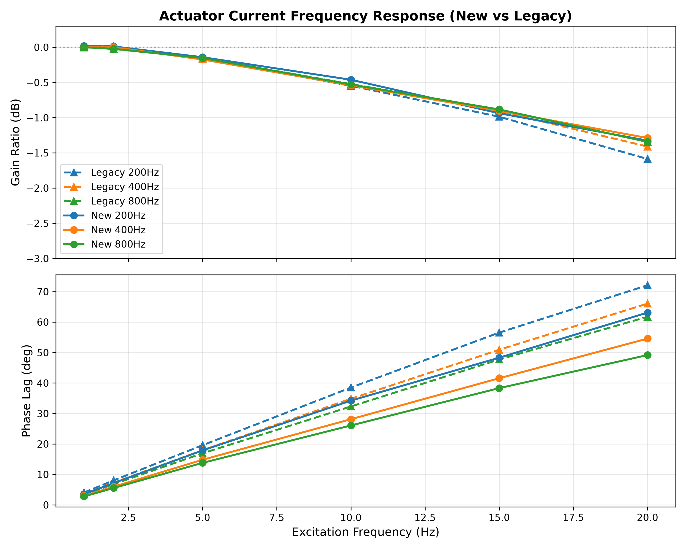
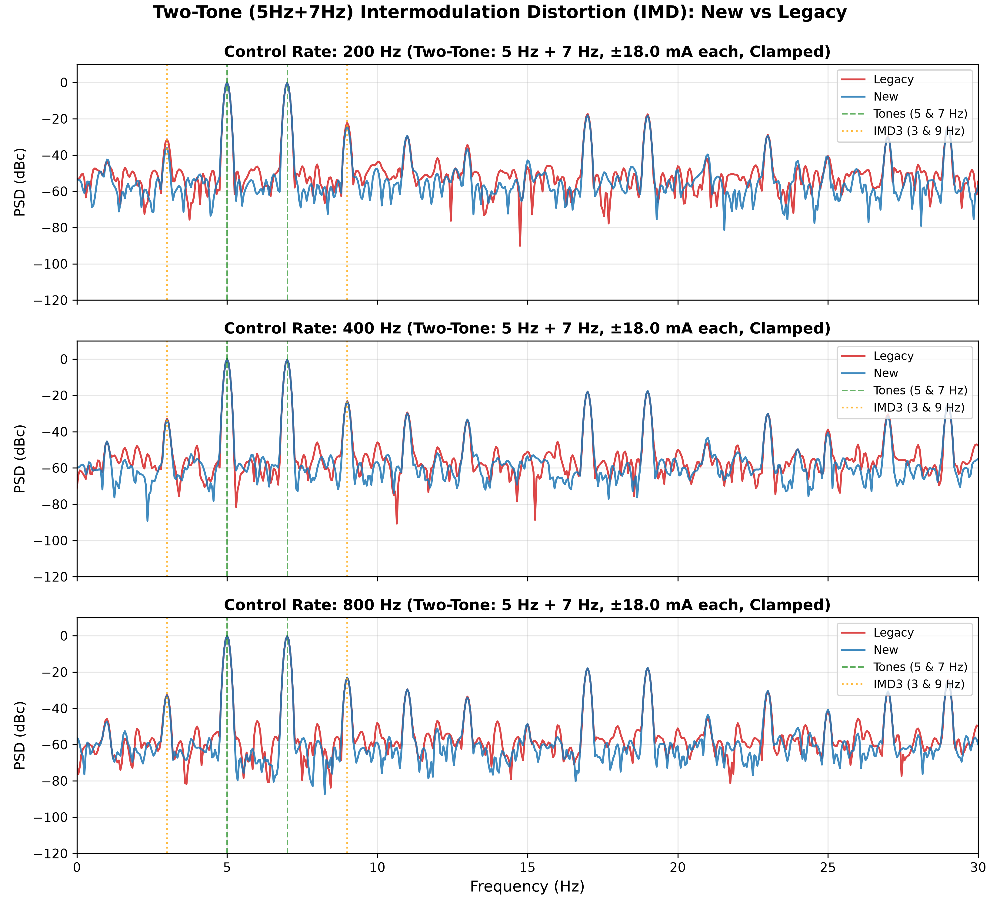
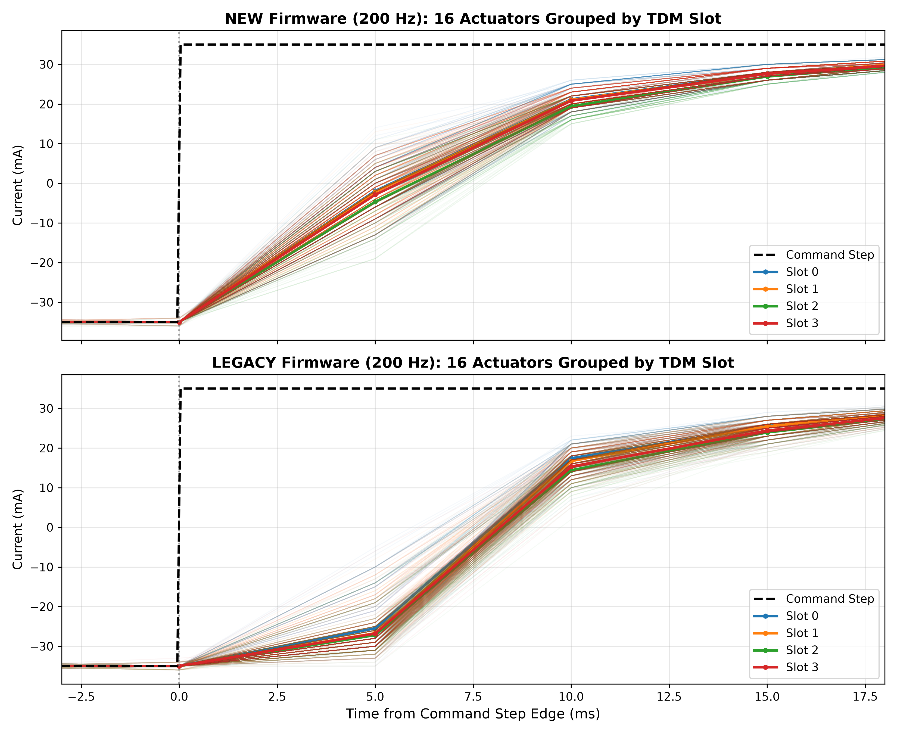
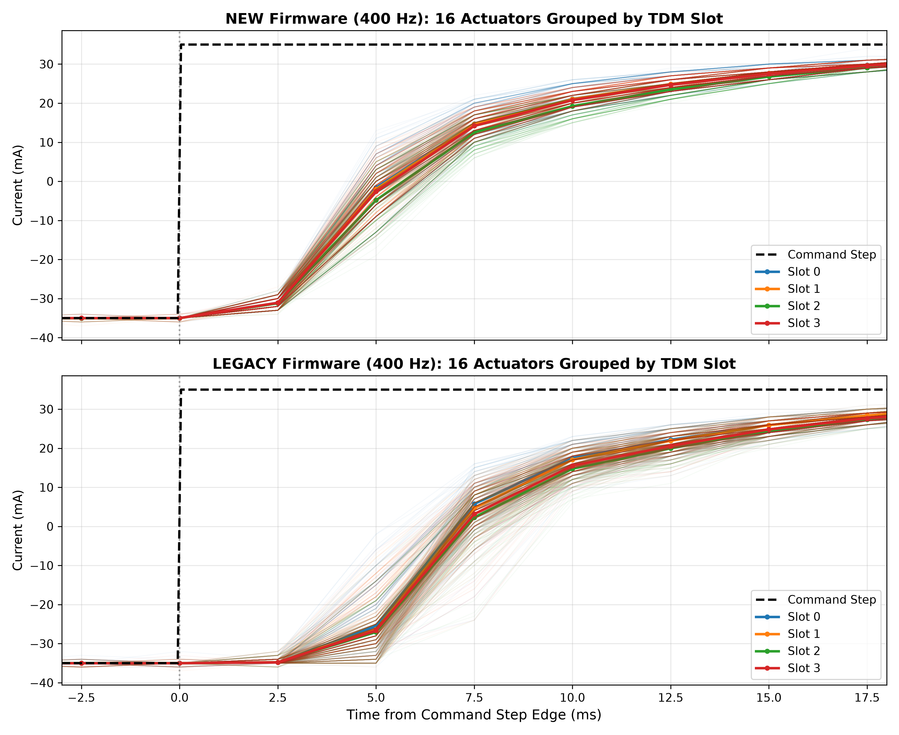
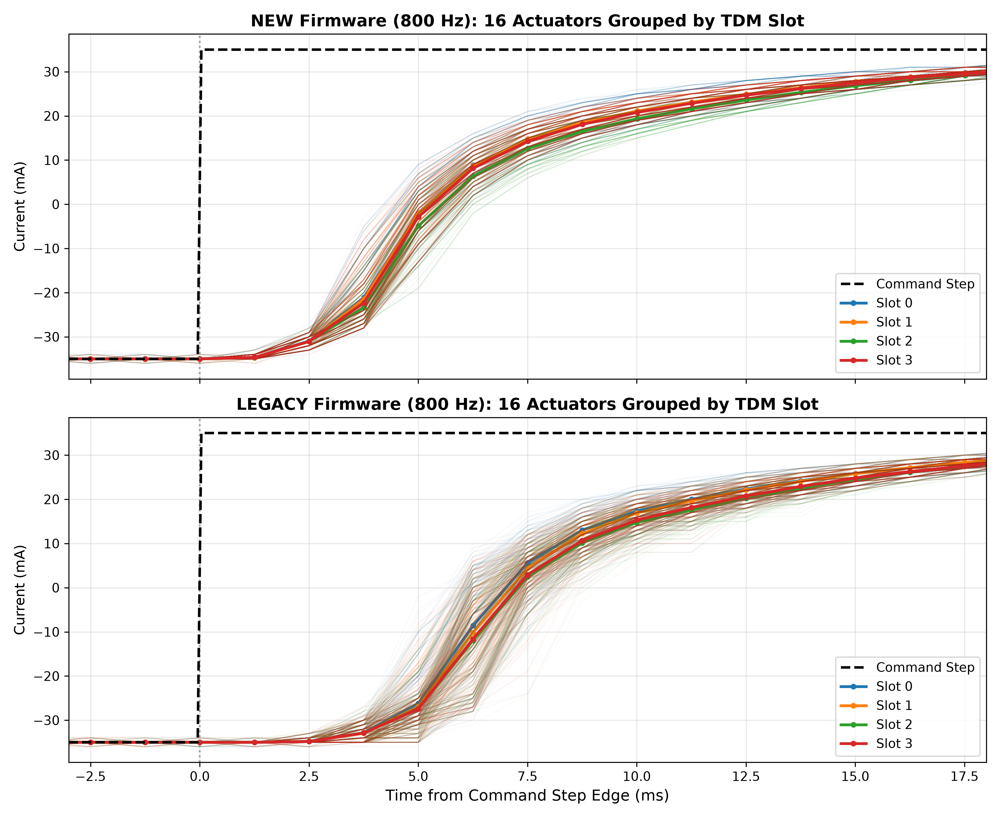
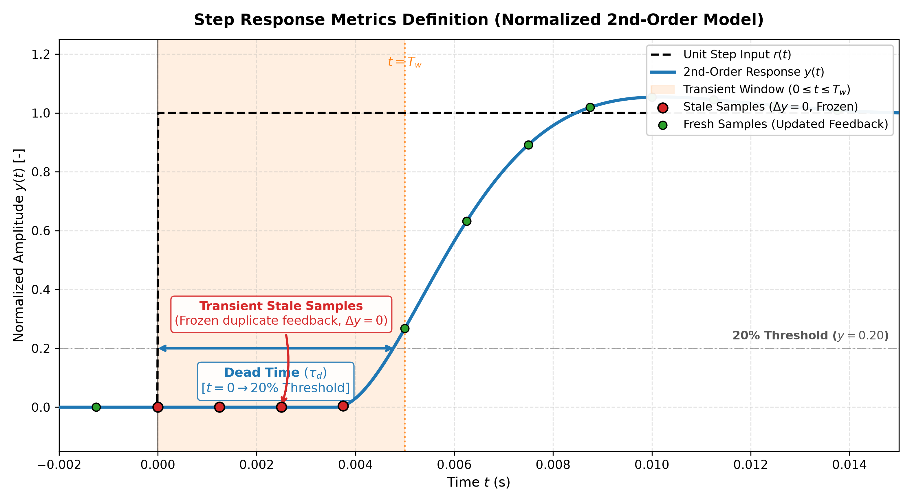
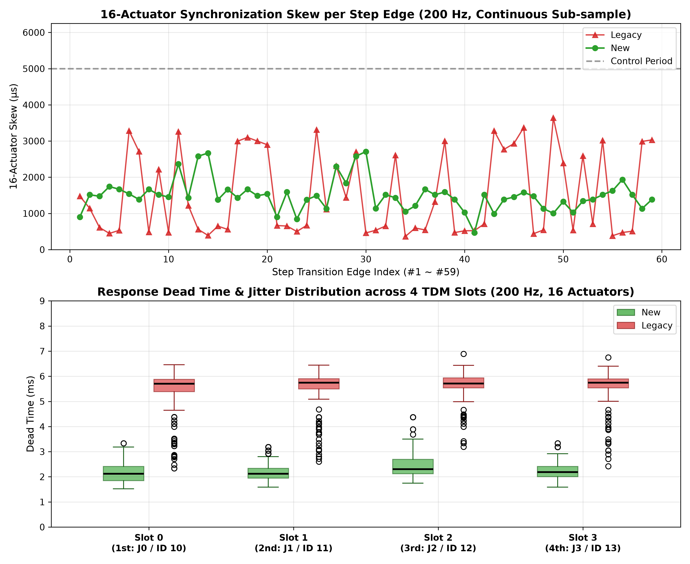
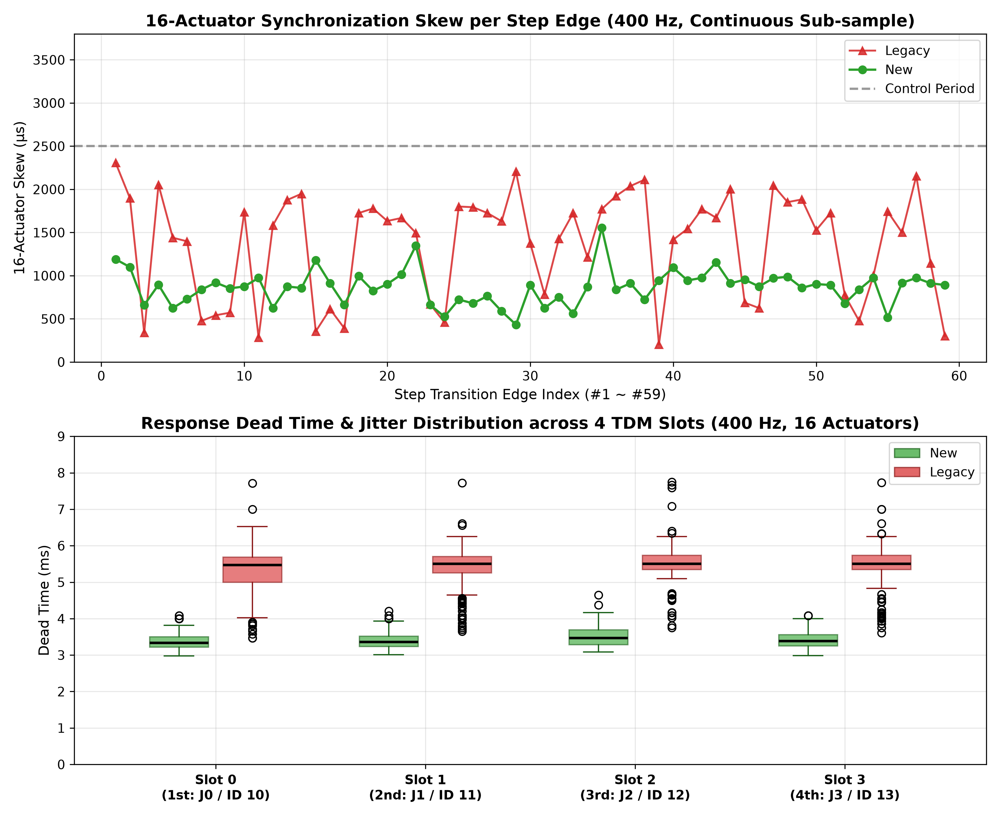
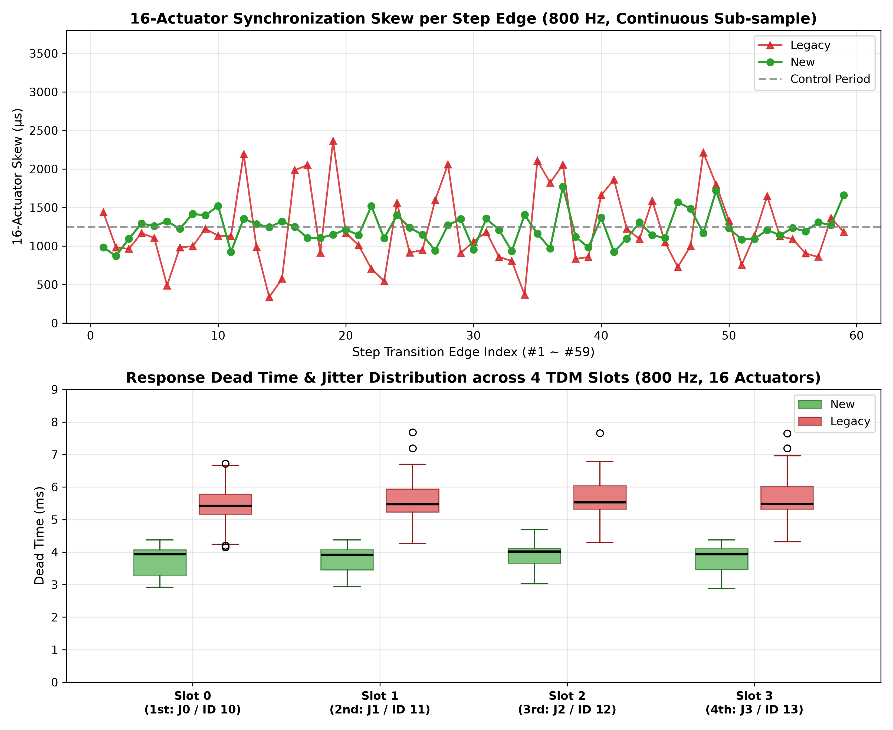

# V6FW_V1.5 벤치마크 결과 보고서

## 1. 개요

본 보고서는 V6 firmware(v1.5)의 통신 및 모터 제어 파이프라인을 대상으로, 입/출력에 대하여 주파수 응답(Bode Plot), 투톤 FFT 스펙트럼, 스텝 과도 응답 및 16축 동기화 스큐 벤치마크 실측 결과를 분석한 문서다.

본 시험에서는  **레거시 펌웨어를 입출력 블랙박스로 간주**하여, 호스트 목표 전류 지령(입력)과 모터 실측 전류 피드백(출력) 간의 응답 특성을 주파수 영역과 시간 영역에서 계측하였다. 또한 레거시 펌웨어의 성능 수준과 문제점을 명확히 대조·식별하기 위해 기준선 역할을 수행할 **대조군 펌웨어**를 사용하여 동일 하드웨어 조건에서 1:1 비교를 수행하였다.

### 1.1 입출력 신호 선정

본 시험은 기계 시스템 동특성을 배제하고 순수 소프트웨어 통신·스케줄링 특성만을 분리 검증하기 위해 관절 각도(위치) 대신 전류 입출력 신호를 채택한다.

- **기계 동역학 영향 배제**: 위치 신호는 관성, 마찰, 백래시 등 기계적 비선형 요소가 개입하므로 펌웨어 고유의 시간 지연과 지터를 파악하기 어렵다.
- **관절 구속 및 미소 전류 인가**: 모든 관절을 물리적으로 고정하고 미소 전류($\pm 35.0\text{ mA}$)를 인가하여 로터 회전을 백래시 범위($< 1.5^\circ$) 내로 억제한다. 기계 동역학(관성, 마찰) 및 역기전력($e \approx 0$)을 차단하고, 초고속 내부 코일 응답($>1\text{ kHz}$)을 제외한 **지배적(Dominant) 1차 계측 LPF 지연계**로 단순화한다.
- **전류 계측 저역통과 필터(LPF) 특성**: 액추에이터 내부 전류 센싱 회로에는 스위칭 노이즈 및 에일리어싱 방지를 위한 1차 저역통과 필터($\tau_{\text{motor}} \approx 4.76\text{ ms}$, $f_c \approx 33.4\text{ Hz}$)가 존재한다. 따라서 보드 선도 이득비는 고주파(20 Hz)로 갈수록 필터 특성에 따른 미세한 감쇠($-1.34\text{ dB}$)가 발생하며, 계측 위상 지연 역시 필터 고유 지연 성분을 포함한다.
- **소프트웨어 지연 분리 (하드웨어 필터 지연 상쇄)**: 총 계측 시간 지연은 소프트웨어의 제어 파이프라인의 수송 지연과 모터 계측 필터 지연의 합($\tau_{\text{total}} = \tau_{\text{pipeline}} + \tau_{\text{motor}}$)으로 구성된다. 대조군과 레거시 펌웨어는 동일한 모터 하드웨어를 공유하므로, 두 펌웨어 간 차분 비교($\Delta \tau = \tau_{\text{legacy}} - \tau_{\text{reference}}$) 시 하드웨어 LPF 지연 성분은 완전히 상쇄되어 펌웨어 내부 패킷 처리, 스케줄링 및 버스 통신 파이프라인의 순수 수송 지연과 지터만을 정밀하게 분리 평가할 수 있다.

### 1.2 실험 조건 및 파라미터 규격
- **제어 모드**: 전류 제어 모드 (`OpMode = 0`, 토크 제어)
- **가진 신호 규격**:
  - 주파수 스위프: $1.0, 2.0, 5.0, 10.0, 15.0, 20.0\text{ Hz}$ 정현파 (진폭 $\pm 25.0\text{ mA}$)
  - 투톤(Dual-Tone) IMD: $f_1 = 5.0\text{ Hz} + f_2 = 7.0\text{ Hz}$ (각 $\pm 18.0\text{ mA}$)
  - 스텝(Step) 응답: $1.0\text{ Hz}$ 대칭 사각파 (진폭 $\pm 35.0\text{ mA}$, 119개 엣지)
- **제어 주파수(Control Frequency)**: 옥타브 스케일링 ($200\text{ Hz} \to 400\text{ Hz} \to 800\text{ Hz}$)
- **대상 액추에이터**: 엄지 제외 4개 손가락의 16개 관절 (ID 10~13, 4개 TDM 슬롯)

---

## 2. 주파수 응답 및 보드 선도 분석

### 2.1 이득 감쇠
보드 선도 상단 플롯에서 주파수 상승에 따라 이득이 최대 -1.34 dB (20 Hz)까지 감쇠하는 현상이 관측된다.

- **기계 동역학 영향 배제**: 전 관절의 회전 변위가 백래시 범위 내($< 1.58^\circ$)로 억제되어 역기전력 및 기계 관성 영향은 배제된다.
- **모터 1차 LPF 모델 일치**: 실측 감쇠 곡선은 액추에이터 드라이버 내부의 1차 저역통과 필터($\tau_{\text{motor}} \approx 4.76\text{ ms}$, $f_c \approx 33.4\text{ Hz}$) 이론 전달함수 크기($|G(20\text{Hz})| = 0.857$, $-1.34\text{ dB}$)와 일치한다.
- **하드웨어 기저 특성 확정**: 대조군과 레거시 펌웨어 및 제어 주파수(200~800 Hz) 전반에서 동일하게 -1.34 dB로 수렴한다. 따라서 해당 감쇠는 실험 오류나 펌웨어 결함이 아닌 모터 하드웨어 고유의 계측 필터 특성이다.

### 2.2 통신 파이프라인 시간 지연 비교
보드 선도 하단 위상 지연($\theta > 0^\circ$) 곡선은 두 펌웨어 모두 주파수에 비례하여 선형 증가한다.

- **시간 지연 격차**: 모터 계측 필터 시정수($\tau_{\text{motor}} \approx 4.76\text{ ms}$)는 두 펌웨어가 동일하게 공유하므로, 위상차로부터 유도되는 시간 지연 격차는 오롯이 펌웨어 통신 파이프라인의 수송 지연 차이($\Delta \tau$)이다:
  $$\Delta \tau = \tau_{\text{transport, legacy}} - \tau_{\text{transport, reference}} \approx 1.75\text{ ms}$$
- **성능 판정**: 레거시 펌웨어는 전 제어 주파수 및 대역에서 대조군 펌웨어 대비 약 $1.75\text{ ms}$ 더 큰 시간 지연을 유발한다. 800 Hz 제어 조건 기준 등가 시간 지연은 대조군 펌웨어($7.71\text{ ms}$) 대비 레거시 펌웨어가 $9.47\text{ ms}$로 측정되어, 레거시 펌웨어의 종단간 통신 및 처리 파이프라인에서 $1.75\text{ ms}$의 지연이 발생함을 확인하였다. (주파수별 세부 계측 수치는 부록 참조)

---

## 3. FFT 스펙트럼 기반 소프트웨어 진단

$f_1 = 5.0\text{ Hz}$ 및 $f_2 = 7.0\text{ Hz}$ 투톤 시험 신호를 인가하여 주파수 영역의 소프트웨어 결함을 진단하였다:

- **투톤(Dual-Tone) 신호 선정 배경**: 단일 정현파로는 식별하기 어려운 통신 버퍼링 지연, 과거 데이터 재전송, 실행 주기 탈조 등에 따른 상호변조 왜곡(IMD)과 기생 스퍼를 민감하게 검출하기 위해 채택하였다.
- **주파수($f_1 = 5.0\text{ Hz}, f_2 = 7.0\text{ Hz}$) 선정 이유**:
  - **서로소(Coprime) 정수비**: 5 Hz와 7 Hz는 서로소 비율로, 상호변조 급수($|m f_1 \pm n f_2| = 2, 3, 9, 11, 12\text{ Hz}$ 등)가 기본파와 겹치지 않아 비조화 대역 결함을 명확하게 분리할 수 있다.
  - **모터 필터 대역 준수**: 모터 저역통과 필터 차단 주파수($f_c \approx 33.4\text{ Hz}$)보다 충분히 낮은 대역에 배치하여, 하드웨어 필터 감쇠 없이 순수 펌웨어 통신의 스펙트럼 순도를 계측한다.

#### 검증 결과

투톤 신호 분석 결과, 레거시 펌웨어에서 주파수 스펙트럼 왜곡이나 이상 잡음과 같은 주파수 영역의 소프트웨어 결함은 관측되지 않았다.

- **모터 및 회로 고유 특성 일치**: 스펙트럼에 나타난 특정 주파수 피크(3, 9, 11 Hz 등)는 모터 마찰과 인버터 회로의 물리적 특성에서 발생하는 정상 신호이다. 대조군과 레거시 펌웨어의 크기가 0.5 dB 이내로 일치하여 펌웨어 결함이 아님을 확인하였다.
- **소프트웨어 잡음 및 파형 왜곡 부재**: 정상 신호 주변 대역에서 바탕 잡음(Noise Floor)이 들뜨거나 엉뚱한 찌꺼기 신호(기생 스퍼)가 솟아오르지 않았다. 즉, 데이터 누락이나 수치 연산 오류 같은 소프트웨어적 결함은 검출되지 않았다. (진단 프로토콜 및 세부 수치는 부록 B 참조)

---

## 4. 스텝 과도 응답 및 실시간 갱신 특성 분석

#### 제어 주파수별 스텝 응답 앙상블 플롯 (Ensemble Plot)
목표 전류 스텝(-35 mA -> +35 mA) 인가 시점($t=0$)을 기준으로 16개 모터의 실제 응답 파형 앙상블을 시간축에 중첩 시각화한 도면이다.

- **앙상블 궤적 수**: 16개 관절 $\times$ 59회 스텝 반복 = 단일 패널당 총 944개 궤적 (4개 통신 슬롯당 각 236개).
- **흐릿한 배경 선**: 총 944회의 실제 개별 응답 파형이며, 선들이 번져 보이는 가로 폭은 응답 시점의 통계적 지터(Jitter)를 나타낸다.
- **굵은 실선 및 마커**: 통신 슬롯(Slot 0~3)별 앙상블 평균 궤적이며, 원형 마커는 펌웨어의 실제 이산 샘플링 시점을 나타낸다.

### 4.1 스텝 과도 응답 지표

#### 스텝 응답 주요 지표 정의 개념도

- **무응답 시간(Dead Time, $\tau_d$)**: 목표 스텝 지령($t=0$) 인가 후, 실측 응답이 목표 변화량의 20%($y = 0.20$)에 처음 도달할 때까지 걸리는 최초 반응 지연 시간이다.
- **과도 데이터 정체율(Transient Stale Data Rate)**: 지령 인가 직후 5 ms 과도 구간($0 \le t \le T_w$, $T_w = 5\text{ ms}$) 동안 호스트가 수신한 피드백 중 직전 샘플과 완전히 동일한 값($\Delta y = 0.0\text{ mA}$)을 갖는 중복 데이터의 비율이다.
  - **5 ms 구간 선정 배경**: 모터 시정수($\tau_{\text{motor}} \approx 4.76\text{ ms}$) 및 기준 제어 주기(200 Hz = 5.0 ms)에 상응하는 시간으로, 스텝 지령 직후 가장 신속한 피드백 갱신이 요구되는 초기 과도 대역이다.
  - **정체 판별 기준 ($\Delta y = 0.0\text{ mA}$)**: 모터 전류 피드백은 1 mA 단위 정수로 수신되므로, 연속 두 샘플 간 차이가 0.0 mA인 경우는 통신 버퍼에서 직전 주기 패킷이 그대로 복제·반복 전송된 정체 샘플임을 뜻한다. (200 Hz 조건은 5 ms 내 샘플이 1개뿐이므로 집계상 0.00%로 산출됨)

| 펌웨어 구분 | 제어 주파수 (Hz) | 무응답 시간 (ms) | 과도 데이터 정체율 (%) |
| :--- | :---: | :---: | :---: |
| **레거시 펌웨어** | 200 | 5.47 | 0.00 |
| | 400 | 5.41 | 78.94 |
| | 800 | 5.54 | 62.75 |
| **대조군 펌웨어** | 200 | 2.25 | 0.00 |
| | 400 | 3.43 | 0.00 |
| | 800 | 3.80 | 21.94 |

### 4.2 무응답 시간 고착 및 과도 데이터 정체 현상

1. **무응답 시간 고착 현상**:
   - 대조군 펌웨어는 2.25 ms ~ 3.80 ms의 빠른 반응을 보인다. 반면 레거시 펌웨어는 200 Hz(5.47 ms), 400 Hz(5.41 ms), 800 Hz(5.54 ms)로 **5.4 ~ 5.5 ms 대역에 그대로 머무른다**.
   - 제어 주파수를 200 Hz에서 800 Hz로 4배 높였음에도, 레거시 펌웨어의 최초 반응 지연 시간은 전혀 줄어들지 않는다.
2. **과도 구간 데이터 정체 현상**:
   - 레거시 펌웨어는 400 Hz에서 반응 구간 샘플의 **78.94%**, 800 Hz에서 **62.75%**가 직전 값과 똑같은 과거 데이터로 계측된다.
   - 지령이 급격히 변하는 동안 피드백이 실시간으로 갱신되지 못해 출력이 계단 모양으로 얼어붙는다. 반면 대조군 펌웨어는 200 Hz 및 400 Hz에서 0.00%의 실시간 갱신율을 유지한다.

### 4.3 시간 영역 및 주파수 영역 교차 검증
서로 다른 두 시험(주파수 스위프 vs 스텝 응답)에서 실측된 레거시 펌웨어의 추가 시간 지연을 상호 대조하였다:

- **주파수 영역 (보드 선도 실측 지연)**: 레거시($9.47\text{ ms}$) - 대조군($7.71\text{ ms}$) = **$+1.76\text{ ms}$**
- **시간 영역 (스텝 무응답 시간)**: 레거시($5.54\text{ ms}$) - 대조군($3.80\text{ ms}$) = **$+1.74\text{ ms}$**

두 독립 시험 간 추가 지연 편차는 **$0.02\text{ ms}$에 불과**하여 높은 수치적 일관성을 보인다. 레거시 펌웨어에서 관측되는 지연이 특정 시험의 우연이 아니라, 제어 파이프라인의 고정된 수송 지연($\approx 1.75\text{ ms}$)에 의한 구조적 현상임을 입증한다.

---

## 5. 16축 동기화 스큐 및 지터 분포 분석

#### 제어 주파수별 동기화 스큐 및 지터 분석 플롯 (Skew & Jitter Analysis Plot)
스텝 지령에 대한 16개 모터의 순시 동기화 오차(상단)와 통신 슬롯별 무응답 시간 통계 분포(하단)를 비교 시각화한 2단 복합 도면이다.

- **상단 플롯 (16축 순시 동기화 스큐 추이)**: 59회의 스텝 전환 순번(#1 ~ #59)마다 16개 관절의 실측 무응답 시간(Dead Time) 중 **최댓값과 최솟값의 차이($\max(\tau_d) - \min(\tau_d)$, $\mu\text{s}$)**를 나타낸다. 회색 점선은 해당 주파수의 1제어 주기 기준선이다.
- **하단 플롯 (TDM 슬롯별 무응답 시간 및 지터 박스플롯)**: 통신 순번(Slot 0~3)별로 16개 모터의 무응답 시간(Dead Time) 중앙값, IQR 지터 분산 폭(박스 높이), 이상치(점) 분포를 비교한 박스플롯(Boxplot)이다.

### 5.1 16축 순시 동기화 스큐 분석
- **다채널 동기화 결여**: 레거시 펌웨어는 400 Hz에서 평균 $1352.8\,\mu\text{s}$, 최대 $2973.0\,\mu\text{s}$의 스큐를 기록하였다. 동일 지령 시점에서도 관절 간 반응 편차가 제어 주기($2500\,\mu\text{s}$)를 초과하여, 복수 통신 버스를 등시성(Isochronous) 있게 일괄 제어하지 못하는 소프트웨어 파이프라인의 한계를 보인다.
- **비결정론적 스케줄링 변동**: 800 Hz 조건에서 스텝 순번(#1 ~ #59)에 따라 스큐가 $300\,\mu\text{s}$에서 $2400\,\mu\text{s}$까지 톱니바퀴 형태로 극심하게 변동하였다. 이는 호스트 지령 수신과 모터 패킷 송수신 간의 소프트웨어 스케줄링 위상이 고정되지 못하고 지속적으로 표류(Drift)하고 있음을 나타낸다.

### 5.2 TDM 슬롯별 지터 및 이상치 분포
- **소프트웨어 실행 지터 분산**: 레거시 펌웨어의 박스 높이(IQR)는 대조군 펌웨어 대비 2배 이상 넓게 형성되어, 통신 패킷 송출 및 회수 시점의 시간적 불확실성이 큼을 보인다.
- **버퍼 지연 고착에 의한 하위 이상치 (200 Hz)**: 레거시 펌웨어 200 Hz의 경우 전체의 82%가 1제어 주기 지연된 $5.7\text{ ms}$에 고착되어 비정상적인 박스를 형성하였다. 소프트웨어 내부 버퍼링으로 인해 1주기 지연이 주류로 굳어지면서, 정상 응답 시간대($2 \sim 4\text{ ms}$)의 샘플들이 오히려 하위 이상치(18%)로 밀려나는 기형적 패턴을 보였다.
- **고속 트랜잭션 처리 지연 (800 Hz)**: 800 Hz 조건에서는 수염 바깥 $7.0 \sim 7.7\text{ ms}$ 대역에 롱테일 이상치가 반복 관측되어, 고속 패킷 스트림 처리 시 소프트웨어 파이프라인의 순간적인 처리 지연 및 프레임 밀림 현상을 입증하였다.

---

## 6. 결론 

대조군 펌웨어와의 1:1 실측 비교를 통해 규명한 레거시 펌웨어의 통신 및 제어 파이프라인이 지닌 소프트웨어 한계는 다음과 같다:

1. **제어 파이프라인의 고정 수송 지연 (1.75 ms 오버헤드)**:
   - 전 주파수 대역에서 대조군 대비 **약 $1.75\text{ ms}$의 추가 수송 지연**이 발생한다.
2. **결정론적 실시간성 결여 및 데이터 정체**:
   - 제어 주파수를 200 Hz에서 800 Hz로 상향해도 무응답 시간은 **$5.4 \sim 5.5\text{ ms}$로 고착**된다. 400 Hz 기준 피드백의 **78.94%가 과거 데이터로 정체**되어 고속 주파수 상향 효과가 상쇄된다.
3. **다채널 등시적 제어 결여**:
   - 16축 동시 구동 시 관절 간 스큐는 400 Hz에서 **최대 $2973\,\mu\text{s}$**로 1제어 주기($2500\,\mu\text{s}$)를 초과하며, 전 대역 기준 **최대 $3952\,\mu\text{s}$**에 달한다. 다채널 통신 버스 간 등시적 제어가 이루어지지 않는다.

### 관절 위치 및 궤적 제어에 미치는 영향

레거시 소프트웨어의 한계는 로봇 손의 각 관절 위치를 정확히 제어하고 여러 관절을 동시에 움직이는 기본 제어 루프에서 다음과 같은 성능 한계로 이어질 수 있다:

1. **위치 제어기 발진 및 강성 저하 (1.75 ms 추가 수송 지연)**:
   - 관절 위치를 목표 각도로 이동시킬 때, 1.75 ms의 추가 지연은 제어 신호의 타이밍을 어긋나게 만든다. 목표 각도에 빠르게 안착시키기 위해 위치 제어 이득(게인)을 조금만 높여도 관절이 덜덜 떨리는 진동(발진)이 발생할 수 있다. 진동을 억제하려면 제어 강도를 낮춰야 하므로, 관절이 단단하게 버티지 못하고 힘없이 물렁해질 가능성이 높다.
2. **급격한 궤적 변경 시 멈칫거림 (5.5 ms 무응답 시간 및 79% 데이터 정체)**:
   - 관절을 급격히 꺾거나 방향을 바꿀 때, 첫 5 ms 동안은 명령이 전달되지 않아 관절이 정지 상태에 머무르고 센서 피드백도 과거 값에 멈춘다. 호스트 PC가 아무리 고속으로 위치 지령을 갱신하더라도 관절이 뚝뚝 끊기듯 뒤늦게 출발하므로, 민첩하고 부드러운 궤적 추종이 제한될 가능성이 크다.
3. **손끝 궤적 왜곡 및 협응 붕괴 (최대 3 ms 동기화 스큐)**:
   - 손끝으로 직선을 그리거나 특정 위치를 가리키려면 손가락의 여러 관절 모터가 정확히 같은 타이밍에 협응하여 회전해야 한다. 하지만 관절마다 동작 시작 시점이 최대 3 ms씩 제각각 어긋나므로, 손끝 이동선이 휘청거리며 찌그러지고 기구학적 계산대로 정확한 위치에 도달하기 어려울 가능성이 높다.

---

## 부록 A: 주파수별 실측 위상 및 시간 지연 데이터

| 제어 주파수 (Hz) | 가진 주파수 (Hz) | 레거시 위상 지연 (deg) | 레거시 시간 지연 (ms) | 대조군 위상 지연 (deg) | 대조군 시간 지연 (ms) | 위상 지연 단축량 (deg) | 시간 지연 단축량 (ms) |
| :---: | :---: | :---: | :---: | :---: | :---: | :---: | :---: |
| 200 | 1.0 | 4.06 | 11.28 | 3.55 | 9.85 | +0.51 | 1.43 |
| | 5.0 | 19.60 | 10.89 | 17.90 | 9.94 | +1.70 | 0.95 |
| | 10.0 | 38.50 | 10.70 | 34.22 | 9.51 | +4.28 | 1.19 |
| | 20.0 | 72.09 | 10.01 | 63.11 | 8.77 | +8.98 | 1.24 |
| 400 | 1.0 | 3.63 | 10.09 | 2.99 | 8.32 | +0.64 | 1.77 |
| | 5.0 | 17.95 | 9.97 | 14.82 | 8.23 | +3.13 | 1.74 |
| | 10.0 | 34.83 | 9.68 | 28.13 | 7.81 | +6.70 | 1.87 |
| | 20.0 | 66.07 | 9.18 | 54.58 | 7.58 | +11.49 | 1.60 |
| 800 | 1.0 | 3.41 | 9.47 | 2.77 | 7.71 | +0.64 | 1.76 |
| | 5.0 | 16.94 | 9.41 | 13.80 | 7.67 | +3.14 | 1.74 |
| | 10.0 | 32.31 | 8.97 | 26.07 | 7.24 | +6.24 | 1.73 |
| | 20.0 | 61.76 | 8.58 | 49.17 | 6.83 | +12.59 | 1.75 |

---

## 부록 B: 투톤 IMD 실측 데이터 및 소프트웨어 결함 진단 기준

### B.1 제어 주파수별 투톤 IMD 왜곡률 실측 데이터

| 제어 주파수 (Hz) | 펌웨어 구분 | 캐리어 진폭 (mA) | 전체 IMD 왜곡률 (%) | 비조화 대역 기생 스퍼 |
| :---: | :---: | :---: | :---: | :---: |
| 200 | 레거시 펌웨어 | 17.0 / 16.6 | 6.44 | 미검출 (정상) |
| | 대조군 펌웨어 | 17.2 / 16.6 | 5.20 | 미검출 (정상) |
| 400 | 레거시 펌웨어 | 17.1 / 16.6 | 5.83 | 미검출 (정상) |
| | 대조군 펌웨어 | 17.1 / 16.6 | 5.63 | 미검출 (정상) |
| 800 | 레거시 펌웨어 | 17.1 / 16.6 | 5.87 | 미검출 (정상) |
| | 대조군 펌웨어 | 17.0 / 16.6 | 5.82 | 미검출 (정상) |

### B.2 투톤 FFT 스펙트럼 기반 소프트웨어 결함 진단 기준

투톤($f_1 = 5\text{ Hz}, f_2 = 7\text{ Hz}$) 입력 시 하드웨어 고유 기수차 IMD 피크($3, 9, 11\text{ Hz}$ 등)를 마스킹한 뒤, 비조화 대역 스펙트럼을 대조군 기준선과 대조하여 다음과 같은 소프트웨어 잠재 결함을 판정한다:

| 결함 유형 | 주파수 영역 발현 시그니처 | 결함 메커니즘 | 본 시험 판정 |
| :--- | :--- | :--- | :---: |
| **비동기 버퍼링 및 데이터 정체** | 피크 간 비조화 대역 sinc형 잡음 바닥 들뜸 | 비동기 버퍼 캐싱으로 인한 과거 데이터 중복 반환 | **미검출 (정상)** |
| **스케줄러 주기 엇박자** | 기본파 양측 비대칭 변조 쌍둥이 스퍼 돌출 | 통신 처리와 모터 폴링 주기 간 위상 밀림 | **미검출 (정상)** |
| **수치 연산 절삭 오류** | 전 대역 양자화 바닥 잡음(Noise Floor) 상승 | 레지스터 스케일링 시 정수 나눗셈 비트 절삭 | **미검출 (정상)** |
| **샘플링 앨리어싱** | 나이퀴스트 경계 반사 비조화 폴딩 스퍼 | 비동기 다운샘플링 시 안티 앨리어싱 필터 부재 | **미검출 (정상)** |
