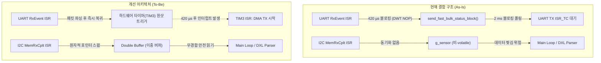

# V6 촉각 센서 MCU (V6_G431) 소프트웨어 아키텍처 및 구현 리스크 평가 보고서

## 1. 개요

V6 촉각 센서 노드(`AHSM_V6_UART_R2`, `AHSS_V6_XX`)[^1] 펌웨어는 로봇 손가락 마디 및 손바닥에 실장되어 3채널 LPS27HHTWTR 기압식 압력 센서 데이터를 200 Hz(5 ms) 주기로 수집하고[^2], 메인 모션 제어기(STM32H743)의 단일선 반이중 UART 버스(4 Mbps) 상에서 다이나믹셀 슬레이브로 공존하는 임베디드 소프트웨어이다[^3].

본 보고서는 반도체 제조사가 제공하는 기본 HAL 드라이버 및 하드웨어/실리콘 계층 특성(NVIC 인터럽트 컨트롤러 설정, Single-Bank Flash 스톨, UART FIFO 하드웨어 구성 등은 자매 보고서인 `V6 촉각 센서 MCU (V6_G431) 하드웨어 및 실리콘 계층 아키텍처 리스크 평가 보고서`에서 다룸)을 제외하고, **순수 사용자 애플리케이션 및 센서 서비스 계층(`V6S_Sense/`, `Src/main.c`)**을 대상으로 소프트웨어적 신뢰성과 실시간 결정론을 위협하는 구조적 한계와 구현 결함을 종합 평가한다. 

시스템 전반의 타이밍 파탄과 데이터 무결성 훼손을 유발하는 **두 가지 근본 아키텍처 결함(다이나믹셀 Fast Read 체이닝 미지원/고지연 블로킹 및 전역 공유 메모리 동시성 경합)**을 서두에서 총괄 분석한 후, 런타임 센싱 파이프라인의 붕괴를 초래하는 **Part 1. 실시간 센싱 파이프라인 및 시스템 설계 리스크**와, 메모리 안전성 및 코드 품질을 저해하는 **Part 2. 세부 구현 결함 및 코드 레벨 리스크**로 체계화하여 정밀 분석한다.

> [!CAUTION]
> 본 보고서는 펌웨어 소스코드와 구현 로직, 산업 표준 소프트웨어 공학 규격(MISRA C:2012, CERT C)에 기반한 정적 코드 분석 결과이므로, 실제 로봇 핸드 하드웨어 런타임 환경에 따라 결함의 발현 빈도나 영향도에 차이가 존재할 수 있다. 또한 본 분석 결과가 대상 시스템의 모든 잠재적 소프트웨어 결함과 안티패턴을 전수 검출했음을 보장하지 않는다.

---

## 2. 주요 리스크 분석

### 2.1 시스템 구조적 특성 및 아키텍처 결함

V6 촉각 센서 노드 펌웨어의 구조적 취약점은 **1) 다이나믹셀 고속 읽기(Fast Sync/Bulk Read 체이닝) 미지원 및 ISR 내 고지연 동기 블로킹** 및 **2) 동기화 프리미티브가 결여된 전역 공유 구조체(`g_sensor`) 기반 데이터 전달**에서 비롯되며, 이는 **3) 센서 데이터 신뢰성 저하 및 버스 충돌 리스크**로 직결된다.

#### 2.1.1. 다이나믹셀 고속 읽기(Fast Read) 체이닝 규격 미준수 및 ISR 내 고지연 동기 블로킹
- **위치**: `V6S_Sense/Src/sensor_dxl_service.c:L22, L32-L33, L231-L290, L420-L456`
- **구조적 특성**:
  단일선 반이중 UART 버스(4 Mbps) 상에서 복수의 다이나믹셀 서보 및 센서가 단일 폴링 프레임으로 데이터를 수집하려면, ROBOTIS 공식 프로토콜 2.0 e-Manual 규격의 **Fast Sync Read (Instruction `0x8A`)** 및 **Fast Bulk Read (Instruction `0x9A`)** 체이닝 응답 규격을 준수해야 한다. 그러나 현재 구현은 로보티즈 공식 규격의 누적 CRC(Running CRC) 체이닝과 버스 상태 감시 메커니즘을 구현하지 않은 채, 임의의 고정 420 µs 비지웨이트 루프로 땜질하여 방치된 상태이다.
- **주요 결합 양상**:
  1. **Fast Sync Read (0x8A) 완전 미구현**:
     - ROBOTIS e-Manual에 명시된 다축 동기 데이터 수집 표준 명령인 `Fast Sync Read (0x8A)`가 소스코드에 아예 정의되어 있지 않다[^4].
  2. **ROBOTIS Protocol 2.0 누적 CRC(Running CRC) 체이닝 규격 위반**:
     - 로보티즈 공식 e-Manual에 따르면, Fast Sync/Bulk Read 응답 시 첫 번째 서보(Slot 0)가 기본 헤더와 초기 CRC를 송출한 후, 후속 슬레이브들(Slot $k > 0$)은 앞선 슬레이브의 패킷을 수신하여 **이전 슬레이브의 CRC-16 계산 상태를 이어받는 누적 CRC(Cumulative/Running CRC)로 자신의 데이터 블록을 체이닝(Hot-chaining)**해야 한다.
     - 그러나 `send_fast_bulk_status_block()`은 이전 패킷의 CRC를 전혀 참조하지 않고, 자신의 독자적인 3~4바이트 데이터만으로 독립 CRC를 계산한다[^5]. 이로 인해 표준 다이나믹셀 마스터 수신기는 CRC 불일치 에러로 패킷을 폐기한다.
  3. **고정 420 µs 비지웨이트 땜질 및 버스 충돌 불가피성**:
     - 후속 슬레이브가 이전 슬레이브의 패킷 완료 직후 지연 없이 바로 체이닝하는 버스 유휴 감지 메커니즘 대신, 짐작에 기반한 `#define DXL_FAST_BULK_RESPONSE_DELAY_US 420U`를 선언하고 `dxl_delay_us(420)`로 시간을 때운다[^6].
     - 관절 모터 개수가 4개가 아니거나(엄지 3축), 특정 모터의 응답 지연/패킷 재전송이 발생하면 420 µs 시점은 버스 상태와 어긋나게 되어, 모터 4번이 아직 송신 중일 때 센서 노드가 트랜시버를 TX로 켜고 패킷을 쏘아 올려 **반이중 버스 충돌(Bus Collision) 및 패킷 전면 파탄**을 초래한다.
  4. **송신 완료 인터럽트 내 최대 2 ms 블로킹**:
     - `HAL_UART_TxCpltCallback` $\rightarrow$ `sensor_dxl_uart_tx_complete` 내부에서 하드웨어 시프트 레지스터 비움을 대기하기 위해 `while ((huart->Instance->ISR & USART_ISR_TC) == 0U)` 폴링 루프(최대 2 ms 가드)를 실행한다[^7].
- **엔지니어링 영향**:
  다이나믹셀 고속 읽기의 체이닝 규격 미준수로 인해 고속 모션 제어 시 패킷 충돌 위험에 상시 노출되며, 단일 인터럽트 핸들러가 최대 420 µs ~ 2 ms 동안 CPU를 독점함으로써 200 Hz I2C 센서 데이터 수집 파이프라인의 실시간성이 파탄된다.

#### 2.1.2. 동기화 프리미티브 결여 및 전역 메모리 동시성 경합
- **위치**: `V6S_Sense/Inc/sensor_service_i2c.h:L58-L85`, `V6S_Sense/Src/sensor_service_i2c.c:L604-L637`, `V6S_Sense/Src/sensor_dxl_service.c:L135-L152`
- **구조적 특성**:
  센서 데이터 구조체 `g_sensor[3]`가 인터럽트 핸들러(I2C MemRxCplt ISR, UART RxEvent ISR)와 백그라운드 슈퍼루프(1ms CAN 송신, 5ms LED 제어, 10ms 모니터) 간에 아무런 뮤텍스, 원자적 연산, 이중 버퍼링 없이 단일 전역 메모리로 직접 공유된다.
- **주요 결합 양상**:
  1. **구조체 필드의 비-volatile 선언**:
     `sensor_ch_t` 구조체 내부에서 오직 `state` 필드만 `volatile`로 선언되어 있으며, 실제 데이터 페이로드인 `pressure_raw`(int32), `value_hpa`(uint16), `temp_raw`(int16), `sample_cnt`(uint32)는 일반 비-volatile 변수로 선언되어 있다[^8].
  2. **원자적 보호 없는 순차 쓰기/읽기**:
     `HAL_I2C_MemRxCpltCallback`에서 압력과 온도를 순차 기록하는 도중에 상위 우선순위 인터럽트나 스케줄러가 개입하여 `build_sensor_table()`을 호출하면, 서로 다른 시점의 압력과 온도가 단일 패킷으로 조립되는 **데이터 찢김(Data Tearing)**이 구조적으로 발생한다[^9].
- **엔지니어링 영향**:
  메인 모션 제어기가 불완전하게 갱신된 압력 데이터나 이전 주기의 온도 데이터를 취득하게 되어, 촉각 기반 접촉 감지 알고리즘에서 스파이크 노이즈 및 판단 지연을 야기한다.

#### 2.1.3. 구조적 결함이 소프트웨어 및 제품 품질에 미치는 영향

1. **소프트웨어 공학적 품질(내부 품질) 영향**:
   - **이식성 및 재사용성 파탄**:
     하드웨어 인터럽트 콜백 내부에 프로토콜 지연 시간(420 µs)이 하드코딩되어 있어, 모터 수량이 바뀌거나 보드레이트가 변경될 때마다 하위 통신 드라이버 전반을 재튜닝해야 한다.
   - **정적 분석 및 검증 차단**:
     Cortex-M4 하드웨어에 존재하지 않는 Cortex-M7 D-Cache 클린 매크로(`SCB_CleanDCache_by_Addr`)가 레거시 복사로 잔존하는 등 코드 무결성이 훼손되어 있다.
2. **제품 및 운용 품질(외부 품질) 영향**:
   - **센서 샘플 드롭 및 통신 프레임 손실**:
     UART ISR 내부의 420 µs 블로킹으로 인해 200 Hz I2C DMA 수신 완료 시점이 지연되어 I2C 버스 오버런 또는 타이밍 지터가 발생한다.
   - **UART 수신 오버런(ORE) 간헐적 누적**:
     모터 반이중 통신 트래픽 처리 후 RX 재무장이 늦어져 `g_dxl_ore_count`가 지속적으로 증가하며, 메인보드의 센서 조회 요청에 대한 무응답 결함으로 발현된다.

---

### 2.2 세부 위험도 분류 체계 및 판정 기준

| 위험도 등급 | 심각도 정의 |
| :--- | :--- |
| **상 (High)** | 통신 버스 충돌, 인터럽트 데드락/스타베이션, 동시성 데이터 찢김, 시스템 에러 은폐를 초래하는 치명적 결함 |
| **중 (Medium)** | 샘플링 지터 유발, 통신 오버런 누적, CPU 버스 스톨, C 표준 미준수 및 가독성/유지보수성 저해 안티패턴 |
| **하 (Low)** | 미사용 레거시 코드 잔존, 컴파일 경고 가능성, 사소한 최적화 미흡 등 즉각적인 기능 정지를 유발하지 않는 항목 |

---

### 2.3 Part 1. 실시간 센싱 파이프라인 및 시스템 설계 리스크

#### 1. 다이나믹셀 고속 읽기(Fast Sync/Bulk Read) 체이닝 규격 미준수 및 고정 420 µs 비지웨이트 땜질 결함
- **위치**: `V6S_Sense/Src/sensor_dxl_service.c:L22, L32-L33, L231-L290, L330-L332`
- **위험도**: **상 (High)**
- **아키텍처 결함 분석**:
  ROBOTIS DYNAMIXEL Protocol 2.0 공식 명세에서 다축 서보 및 센서가 단일 반이중 버스 상에서 통신할 때 충돌을 방지하고 버스 대역폭을 극대화하기 위해 규정한 핵심 명령어는 **Fast Sync Read (0x8A)** 및 **Fast Bulk Read (0x9A)**이다. 본 펌웨어의 구현을 공식 기술 규격과 대조 분석한 결과, 중대한 프로토콜 미준수 및 미완성 구현 결함이 확인된다:
  1. **Fast Sync Read (0x8A) 명령 완전 누락**:
     모션 제어기가 4개 관절 모터와 센서를 단일 프레임으로 1 kHz 동기 폴링하기 위해 사용하는 표준 명령인 `Fast Sync Read (0x8A)`가 소스코드 상에 정의조차 되어 있지 않다(`sensor_dxl_service.c:L19-L22`).
  2. **누적 CRC(Running CRC) 체이닝 알고리즘 결여**:
     ROBOTIS Protocol 2.0 공식 e-Manual에 따르면, Fast Bulk Read에서 첫 번째 슬레이브 이후의 후속 슬레이브(Slot $k > 0$)는 이전 슬레이브의 전송 스트림을 수신하여 누적된 CRC-16 값을 기반으로 자신의 상태 블록(`Error | ID | Data | Updated CRC-16`)을 체이닝해야 한다. 그러나 본 코드는 이전 패킷의 CRC를 전혀 이어받지 않고 자신의 3~4바이트 데이터만으로 단독 CRC(`dxl_crc()`)를 계산하여 송출하므로, 표준 다이나믹셀 마스터에서 필연적으로 CRC 에러를 발생시킨다.
  3. **고정 420 µs 비지웨이트 땜질 (`#define DXL_FAST_BULK_RESPONSE_DELAY_US 420U`)**:
     이전 슬레이브의 패킷 완료 시점을 감시하는 버스 유휴 감지 메커니즘 대신, 임의로 짐작한 고정 상수 `420 µs`를 정의하고 `dxl_delay_us(420)`로 CPU를 동기식으로 태우며 대기한다.
  4. **반이중 버스 충돌(Bus Collision) 불가피성**:
     손가락 관절 수량이 변경되거나(엄지 3축 등), 모터 응답 지연이나 패킷 재전송이 발생하면 420 µs 시점은 버스 상태와 어긋나게 된다. 모터 4번이 아직 송신 중일 때 센서 노드가 트랜시버를 TX로 켜고 패킷을 쏘아 올려 물리 계층 충돌 및 패킷 파탄을 초래한다.
- **소프트웨어 공학 및 표준 검증**:
  ROBOTIS e-Manual DYNAMIXEL Protocol 2.0 명세(Section "Fast Sync Read" 및 "Fast Bulk Read")에 명시된 체이닝 패킷 규격과 일치하지 않으며, 임의의 고정 지연 시간을 하드코딩하는 것은 버스 충돌을 필연적으로 유발하는 구조적 안티패턴이다.
- **잠재적 영향**:
  - **반이중 버스 충돌(Bus Contention)**: 손가락 구조 변경(엄지 3축 등)으로 모터 개수가 다르거나, 모터 응답 지연/패킷 재전송 발생 시 420 µs 시점은 버스 유휴 시점과 어긋나게 된다. 모터 4번이 아직 송신 중일 때 센서 노드가 트랜시버를 TX로 켜고 패킷을 쏘아 올려 물리 계층 충돌 및 패킷 파탄을 초래한다.
  - **대역폭 낭비**: 앞선 모터들의 응답이 일찍 종료되더라도 무조건 420 µs를 허비하여 1 kHz 제어 루프의 가용 통신 마진을 잠식한다.

---

#### 2. ISR 컨텍스트 내 DWT 기반 420 µs 비지웨이트 블로킹 (`dxl_delay_us`)
- **위치**: `V6S_Sense/Src/sensor_dxl_service.c:L69-L86, L253, L420-L437`
- **위험도**: **상 (High)**
- **아키텍처 결함 분석**:
  상기 제1항의 TDM 슬롯 미구현을 땜질하기 위해 도입된 `dxl_delay_us(420)`가 백그라운드 태스크가 아닌 **`HAL_UARTEx_RxEventCallback` 인터럽트 서비스 루틴 내부에서 직접 동기식 비지웨이트로 실행**된다[^6]. CPU가 `__NOP()` 루프를 돌며 420 µs 동안 DWT 카운터를 폴링한다.
- **소프트웨어 공학 및 표준 검증**:
  MISRA C:2012 및 실시간 임베디드 시스템 설계 원칙에 따르면, ISR 내에서 수 마이크로초 이상의 하드웨어 지연이나 폴링 루프를 실행하는 것은 절대 금지된다[^10].
- **잠재적 영향**:
  160 MHz 클록 기준 약 67,200 CPU 사이클 동안 인터럽트 컨텍스트가 묶이게 되며, I2C 버스의 이벤트 인터럽트 및 DMA 완료 인터럽트 처리가 420 µs 동안 전면 차단되어 I2C 센서 데이터 수집 파이프라인의 타이밍 붕괴와 지터를 초래한다.

---

#### 3. 1 ms 슈퍼루프 스케줄러의 비주기적 드리프트 및 슬롯 오버런 누적
- **위치**: `Src/main.c:L245-L261`
- **위험도**: **중 (Medium)**
- **아키텍처 결함 분석**:
  ```c
  dt = now - prev_1ms;
  if (dt >= 1U) {
      if (dt > 1U) { g_loop_1ms_overrun++; }
      prev_1ms = now;
      // ... 1ms 태스크 실행
  }
  ```
  타이머 인터럽트나 하드웨어 RTOS 기반 정주기 스케줄러 대신 `HAL_GetTick()` 폴링 루프로 1 ms 슬롯을 구동하면서, 슬롯 지연 시 `prev_1ms += 1U`가 아닌 `prev_1ms = now`로 현재 틱을 덮어쓴다[^11].
- **소프트웨어 공학 및 표준 검증**:
  실시간 임베디드 주기 태스크에서 시간 기준(Timebase)을 동적으로 덮어쓰는 구조는 지연된 슬롯 시간을 누적 보상하지 못하고 영구적인 위상 드리프트(Phase Drift)와 샘플 누락을 유발한다.
- **잠재적 영향**:
  I2C 버스 복구(360 µs)나 통신 서비스 실행으로 인해 루프 지연이 발생할 때마다 센서 데이터 수집 주기가 불규칙하게 늘어나며, `g_loop_1ms_overrun`이 누적되어 상위 제어기의 1 kHz / 200 Hz 타이밍 동기화를 저해한다.

---

#### 4. UART TX 완료 대기 루틴의 인터럽트 내 최대 2 ms 블로킹 (`USART_ISR_TC` 대기)
- **위치**: `V6S_Sense/Src/sensor_dxl_service.c:L439-L456`
- **위험도**: **상 (High)**
- **아키텍처 결함 분석**:
  DMA 송신 완료 인터럽트(`sensor_dxl_uart_tx_complete`) 내부에서 레벨시프터 방향을 RX로 전환하기 전 하드웨어 시프트 레지스터 비움을 보장하기 위해 다음과 같은 폴링 루프를 실행한다[^7]:
  ```c
  uint32_t t0 = HAL_GetTick();
  while ((huart->Instance->ISR & USART_ISR_TC) == 0U) {
      if ((HAL_GetTick() - t0) >= 2U) { break; } /* 2 ms guard. */
  }
  ```
- **소프트웨어 공학 및 표준 검증**:
  인터럽트 핸들러 내에서 `HAL_GetTick()`을 이용해 타임아웃을 측정하는 것은, `SysTick` 인터럽트가 동일한 우선순위(`Priority 0`)이거나 블로킹되어 갱신되지 못할 경우 무한 루프 또는 예상치 못한 지연을 유발할 수 있다.
- **잠재적 영향**:
  4 Mbps 보드레이트 기준 1바이트 전송에는 2.5 µs가 소요되나, 노이즈나 하드웨어 플래그 지연 시 인터럽트 컨텍스트 내에서 최대 2 ms 동안 CPU가 멈추게 되어 센서 5 ms 수집 주기의 40%를 단일 ISR이 잠식한다.

---

#### 5. I2C 버스 결착 복구 루틴의 동기식 GPIO 클록 비트뱅잉 지연
- **위치**: `V6S_Sense/Src/sensor_service_i2c.c:L274-L314, L490-L520`
- **위험도**: **중 (Medium)**
- **아키텍처 결함 분석**:
  센서 I2C 통신 오류나 버스 결착(SDA Grounding) 감지 시 `i2c_bus_recover()`가 호출되며, SCL 핀을 9회 토글하는 과정에서 매 천이마다 `i2c_delay_10us()`를 호출한다. 토글 1회당 4회의 10 µs 지연이 발생하여 단일 채널 복구에 최소 360 µs 이상의 동기 블로킹이 발생한다[^12].
- **소프트웨어 공학 및 표준 검증**:
  하드웨어 버스 복구 시퀀스는 백그라운드 상태 머신으로 분할 처리되어야 하며, 동기식 딜레이로 실행될 경우 1 ms 메인 폴링 루프의 주기를 크게 교란한다.
- **잠재적 영향**:
  3개 채널 중 복수 채널에서 결착이 동시 발생할 경우 메인 루프 실행 지연이 1 ms를 초과(`g_loop_1ms_overrun` 증가)하여 센서 스트리밍 주기가 불규칙해진다.

---

#### 6. 센서 채널 점유 루틴(`sensor_channel_claim`)의 최대 20 ms 동기식 비지웨이트 블로킹
- **위치**: `V6S_Sense/Src/sensor_service_i2c.c:L753-L764`
- **위험도**: **중 (Medium)**
- **아키텍처 결함 분석**:
  디버그 CLI 명령(센서 테스트, 스캔, 소프트 리셋) 실행 시 DMA 수신 중인 채널과의 충돌을 방지하기 위해 `sensor_channel_claim()`을 호출하며, 다음과 같이 최대 20 ms 동안 비지웨이트로 대기한다[^13]:
  ```c
  uint32_t wait_start = HAL_GetTick();
  while ((s->state == SS_BUSY) && ((HAL_GetTick() - wait_start) < 20U)) {
      /* let the in-flight DMA transfer's ISR complete on its own. */
  }
  ```
- **소프트웨어 공학 및 표준 검증**:
  비동기 DMA 완료를 기다리기 위해 백그라운드 슈퍼루프에서 20 ms 동안 폴링 루프에 갇히는 구조는 실시간 센싱 파이프라인의 메인 루프를 직접적으로 동결시킨다.
- **잠재적 영향**:
  센서 진단 중 1 ms 슈퍼루프의 다른 모든 작업(UART 전송, CAN 센서 스트리밍, DXL 폴링)이 최대 20 ms 동안 완전히 중단되어 상위 제어기와의 통신 단절을 야기한다.

---

### 2.4 Part 2. 세부 구현 결함 및 코드 레벨 리스크

#### 1. `sensor_ch_t` 구조체 필드의 비-volatile 선언 및 크로스-컨텍스트 데이터 찢김
- **위치**: `V6S_Sense/Inc/sensor_service_i2c.h:L58-L82`, `V6S_Sense/Src/sensor_service_i2c.c:L604-L636`
- **위험도**: **상 (High)**
- **표준 위반**: **MISRA C:2012 Rule 8.4, CERT C CON32-C (데이터 경쟁 및 비원자적 접근)**
- **결함 내용**:
  `sensor_ch_t` 구조체에서 오직 `state` 필드만 `volatile` 수식어가 지정되어 있고, `pressure_raw`, `value_hpa`, `temp_raw`, `sample_cnt`는 일반 비-volatile 변수로 선언되어 있다[^8].
- **잠재적 영향**:
  `HAL_I2C_MemRxCpltCallback` ISR이 압력 데이터를 갱신하는 도중에 UART DXL 인터럽트가 선점하여 `build_sensor_table()`을 호출하면, 32비트 정수 `pressure_raw`의 상위/하위 바이트가 서로 다른 샘플에서 취득되는 데이터 찢김이 발생할 수 있다[^9]. 또한 컴파일러 최적화에 의해 레지스터 캐싱이 발생하여 최신 센서 데이터 반영이 누락될 수 있다.

---

#### 2. UART 통신 에러 발생 시 1 ms 강제 RX 비무장으로 인한 요청 유실
- **위치**: `V6S_Sense/Src/sensor_dxl_service.c:L458-L484, L413-L417`
- **위험도**: **상 (High)**
- **표준 위반**: **CERT C ERR30-C (에러 상태 처리 부실)**
- **결함 내용**:
  `sensor_dxl_uart_error()`에서 ORE, FE, NE 등 하드웨어 에러 발생 시 하드웨어 플래그를 클리어한 후 `s_dxl_rx_armed = 0U;` 및 `s_dxl_retry_tick = HAL_GetTick();`을 설정하여 RX를 강제 해제한다. 이후 1 ms 슬롯의 `sensor_dxl_service_poll()`에서 1 ms가 경과할 때까지 RX가 재무장되지 않는다[^14].
- **잠재적 영향**:
  다이나믹셀 버스 상에서 사소한 노이즈로 1바이트 Framing Error가 발생했을 뿐인데, 향후 1 ms 동안 수신 DMA가 정지되어 메인보드의 후속 센서 READ 요청을 연속해서 드롭하는 통신 단절을 초래한다.

---

#### 3. Cortex-M4 아키텍처에 무의미한 Cortex-M7 D-Cache 매크로 잔존
- **위치**: `V6S_Sense/Src/sensor_dxl_service.c:L100-L102, L183-L185, L250-L252, L430-L432`
- **위험도**: **하 (Low)**
- **표준 위반**: **MISRA C:2012 Rule 1.1 (미지원 아키텍처 의존 코드 방치)**
- **결함 내용**:
  STM32G431은 L1 데이터 캐시가 없는 ARM Cortex-M4F 코어임에도 불구하고, STM32H7 레거시 프로젝트에서 복사해 온 `#if defined(__DCACHE_PRESENT) && (__DCACHE_PRESENT == 1U)` 조건문 및 `SCB_CleanDCache_by_Addr`, `SCB_InvalidateDCache_by_Addr` 호출 코드가 방치되어 있다[^15].
- **잠재적 영향**:
  실제 런타임에는 조건부 컴파일로 제외되지만, 코드 유지보수자에게 하드웨어 캐시 아키텍처에 대한 혼선을 유발하고 코드 검증 신뢰도를 저하시킨다.

---

#### 4. WS2812B PWM DMA 전송 중 버퍼 수정 및 강제 정지 레이스 컨디션
- **위치**: `V6S_Sense/Src/ws2812.c:L115-L134`
- **위험도**: **중 (Medium)**
- **표준 위반**: **CERT C CON33-C (비동기 리소스 조기 종료 레이스)**
- **결함 내용**:
  `ws2812_set_rgb()`는 `s_busy != 0`일 때 DMA가 아직 동작 중임에도 `HAL_TIM_PWM_Stop_DMA()`를 호출하여 강제 정지시킨 후 `s_pwm_buf`를 덮어쓴다. 인터럽트 마스킹 없이 타이머 채널과 DMA 레지스터를 직접 조작한다[^16].
- **잠재적 영향**:
  타이머가 펄스 출력 도중 강제 중단되어 비정상 듀티의 펄스가 WS2812B로 유입되면, 스마트 LED 내부 시프트 레지스터가 오동작하여 LED 색상이 엉뚱하게 튀거나 래치가 잠기는 현상을 유발한다.

---

#### 5. DXL 패킷 파서의 선형 루프 내 잠재적 버퍼 인덱스 오버런 취약점
- **위치**: `V6S_Sense/Src/sensor_dxl_service.c:L360-L373, L312-L317`
- **위험도**: **중 (Medium)**
- **표준 위반**: **MISRA C:2012 Rule 18.1, CERT C ARR30-C (배열 범위 초과 접근)**
- **결함 내용**:
  `handle_packet()`에서 `for (uint16_t i = 0U; (i + 10U) <= size; i++)` 루프로 헤더를 검색한 후, `handle_packet_at(&buf[i], (uint16_t)(size - i))`를 호출한다[^17]. 패킷 길이 필드(`length`) 판독 시 `total = length + 7U` 계산 후 `total > size` 가드를 두고 있으나, 노이즈로 인해 `length`가 비정상적인 값으로 수신될 때 음수나 언더플로우 발생 시의 방어 코드가 미흡하다.
- **잠재적 영향**:
  악의적이거나 손상된 노이즈 패킷 수신 시 불필요한 CRC 연산 루프를 수행하여 인터럽트 처리 지연을 가중시킨다.

---

#### 6. I2C 수신 원시 데이터의 부호 없는 24비트 연산 후 부호 확장 시 타입 캐스팅 모호성
- **위치**: `V6S_Sense/Src/sensor_service_i2c.c:L126-L132, L624-L629`
- **위험도**: **중 (Medium)**
- **표준 위반**: **MISRA C:2012 Rule 10.3, Rule 10.4 (부호 있는/없는 정수 혼용 연산)**
- **결함 내용**:
  ```c
  static int32_t sign_extend24(uint32_t v) {
      if ((v & 0x00800000UL) != 0UL) {
          v |= 0xFF000000UL;
      }
      return (int32_t)v;
  }
  ```
  `uint32_t` 비트 마스킹 연산 후 `(int32_t)v`로 단순 명시적 캐스팅을 수행한다[^18]. 2의 보수 표현 체계에서 최상위 비트가 1인 경우 부호 없는 정수를 부호 있는 정수로 캐스팅하는 것은 C 표준(C99 6.3.1.3)상 Implementation-defined 거동에 해당한다.
- **잠재적 영향**:
  ARM GCC 환경에서는 정상적으로 부호 확장되지만, MISRA C 정적 분석 도구에서 필수 규칙 위반으로 적발되며 컴파일러 최적화 레벨 변경 시 잠재적 위험 요인이 된다.

---

#### 7. 부팅 스플래시 루프 내 워치독 킥 및 부팅 배너 위장으로 인한 결함 은폐
- **위치**: `Src/main.c:L94-L98, L135-L140, L213-L222`, `V6S_Sense/Src/ws2812.c:L98-L108`
- **위험도**: **중 (Medium)**
- **표준 위반**: **CERT C ERR07-C (결함 상태 위장 및 은폐)**
- **결함 내용**:
  소스코드 주석에 명시적으로 기술되어 있듯이[^19]:
  ```c
  /* Fallback "resting-state" reading used for the boot indicator and for the
   * I2C1-unavailable fallback color, so a watchdog-reset reboot or a sensor
   * fault renders the same steady blue as normal idle operation instead of
   * standing out (rainbow splash / LED-off). By Rick 2026-06-30 */
  ```
  워치독 리셋으로 시스템이 재부팅되거나 센서 통신이 단절되어도 정상 상태와 동일한 고정 파란색(`1020 hPa` 상당)을 출력하도록 의도적으로 결함을 은폐(Masking)하도록 구현되어 있다.
- **잠재적 영향**:
  필드 운용 중 센서 노드가 워치독에 의해 주기적으로 리셋되거나 센서 ASIC이 먹통이 되어도 작업자나 유지보수 인력이 육안으로 결함 상태를 인지하지 못하여 잠재적 오동작 사고로 이어진다.

---

#### 8. 런타임 센서 결함 격리(`s_declared_faulty`) 후 자동 복원 메커니즘 부재 및 파워온 리셋 종속성
- **위치**: `V6S_Sense/Src/sensor_service_i2c.c:L223-L225, L247-L249, L451-L506`
- **위험도**: **상 (High)**
- **표준 위반**: **CERT C ERR00-C (에러 복구 절차 부실), MISRA C:2012 Rule 16.3**
- **결함 내용**:
  `sensor_service_i2c_poll()`에서 일시적 노이즈나 결착으로 소프트 리셋 재시도가 3회(`SENSOR_LOCKUP_SOFT_RETRY_LIMIT`) 실패하면 해당 채널을 영구 결함 상태(`s_declared_faulty[ch] = 1`)로 격리(Parked)한다[^20].
  - 런타임에 이 플래그를 주기적으로 재평가하거나 자동 해제하는 백그라운드 복구 로직이 전무하다.
  - 상위 다이나믹셀 버스 프로토콜 상에서도 해당 플래그를 해제하거나 센서 칩을 리셋하는 프로토콜 명령어가 구현되어 있지 않다 (오직 UART2 디버그 콘솔 CLI `sensor_service_i2c_clear_faulty`만 존재).
  - 센서 하드웨어 전원 제어 핀(Power-Cycle Pin)이 없기 때문에, 상위 보드가 통신 실패를 감지하여 MCU를 소프트웨어 리셋(`NVIC_SystemReset`)하거나 워치독 리셋(IWDG)을 발생시키더라도 센서 자체는 VDD가 유지되어 락업 상태를 지속한다.
  - 따라서 오직 전체 핸드 전원을 차단하여 VDD를 0V로 방전시키고 MCU BSS 메모리를 0으로 재초기화하는 **"파워온 리셋(Power-on Reset)"만이 이 격리 상태를 해제할 수 있는 유일한 경로**로 고착되어 있다.
- **잠재적 영향**:
  필드 운용 중 순간적인 정전기(ESD)나 외력 충격으로 1회 소프트 리셋 시퀀스가 실패하면, 센서가 물리적으로 정상 회복되더라도 펌웨어가 해당 센서를 영구적으로 배제하여 핸드 전체 전원을 재인가하기 전까지 촉각 피드백이 영구 상실된다.

---

#### 9. 센서 초기화 시 하드코딩된 동기식 `HAL_Delay(5U)` 블로킹 및 전원 인가 지연 부실 처리
- **위치**: `V6S_Sense/Src/sensor_service_i2c.c:L419-L425`
- **위험도**: **중 (Medium)**
- **표준 위반**: **CERT C ERR04-C (초기화 타이밍 및 하드웨어 준비 상태 검증 부실)**
- **결함 내용**:
  `sensor_service_i2c_init()`에서 센서 VDD 인가 후 NVM 파라미터 로딩 완료를 기다리기 위해 `HAL_Delay(5U)`로 단 5 ms의 동기식 지연만 대기한다[^21]. 센서의 준비 완료 여부를 레지스터나 상태 폴링으로 확인하지 않고 고정된 최소 마진 시간에 의존한다.
- **잠재적 영향**:
  FPCB 선로 기생 임피던스나 레귤레이터 편차로 전원 상승이 단 0.5~1 ms만 늦어지는 특정 보드/포트의 경우, 센서 NVM 로딩 미완료 상태에서 I2C 읽기가 시도되어 부팅 시 프로빙 실패가 발생한다. 이는 부팅 직후 복구 루틴 진입 및 영구 결함 파킹(`s_declared_faulty`)으로 이어져, 특정 보드에서 간헐적으로 압력이 읽히지 않는 개체 편차 결함을 초래한다.

---

## 3. 센싱/통신 파이프라인 최적화 및 구조 개선 로드맵

상기 식별된 소프트웨어 아키텍처 및 구현 리스크들을 근본적으로 해소하고 고신뢰성 실시간 센싱 파이프라인을 구축하기 위한 개선 방안을 제시한다.



### 1) 인터럽트 내 420 µs 블로킹 제거 (하드웨어 타이머 원샷 트리거)
- **개선안**:
  `dxl_delay_us(420)` 폴링 루프를 전면 제거하고, 저주파수 하드웨어 타이머(예: `TIM3` 원샷 타이머)를 420 µs로 기동한 뒤 ISR을 즉시 종료한다. 420 µs 후 타이머 인터럽트 콜백에서 `HAL_UART_Transmit_DMA`를 기동함으로써 CPU를 420 µs 동안 완전 해방시킨다.

### 2) 다중 계층 선점형 인터럽트 우선순위 재배치
- **우선순위 0 (최상위)**: 고속 UART DXL Rx/Tx 인터럽트 및 DMA 채널 (수신 오버런 방지).
- **우선순위 1**: I2C1..3 EV/ER 인터럽트 및 DMA 채널 (센서 데이터 수신).
- **우선순위 2**: SysTick 및 저속 타이머 인터럽트.
- **우선순위 3 (최하위)**: 디버그 VCP (USART2) DMA 인터럽트.

### 3) 이중 버퍼링(Double Buffering) 도입을 통한 데이터 찢김 원천 차단
- 센서 수집 버퍼를 `Front Buffer`와 `Back Buffer`로 분리한다.
- I2C DMA 완료 ISR은 `Back Buffer`에 3채널 데이터를 완전히 기록한 후 원자적 포인터 스왑(`Atomic Pointer Swap`)을 수행하고, DXL 슬레이브와 메인 루프는 항상 안전한 `Front Buffer`만 참조하도록 격리한다.

### 4) 플래시 파라미터 백그라운드 큐잉
- 메인 센싱 루프 도중 동기식 플래시 소거를 금지하고, 로봇 핸드가 정지 중이거나 통신 아이들 상태일 때만 안전하게 저장하도록 전용 저장 상태 머신을 구축한다.

### 5) 결함 채널 자율 재프로빙 및 전원 인가 마진 확장
- `s_declared_faulty` 선언으로 파킹된 채널이라도 영구 방치하지 않고, 백그라운드에서 일정 주기(예: 5초~10초)마다 `WHO_AM_I`를 재조회하여 센서가 정상 응답할 경우 `sensor_service_i2c_clear_faulty()`를 자동 호출하여 런타임에 센싱을 자동 복구한다.
- 부팅 시 `HAL_Delay(5U)`를 비동기 타이머 기반의 20 ms 안정화 지연으로 대체하여 전원 슬루율 편차에 의한 초기 프로빙 실패를 원천 방지한다.

---

## 4. 종합 평가 및 결론

V6 촉각 센서 MCU 펌웨어는 3개 독립 I2C 채널과 단일선 반이중 4 Mbps DXL 통신을 초소형 풋프린트 내에서 구현한 높은 하드웨어 집약성을 보여준다. 그러나 소스코드 기반 정적 분석 결과, **다이나믹셀 Fast Read 체이닝 규격 미준수 및 ISR 내부의 420 µs 비지웨이트 블로킹**, **동기화 프리미티브가 결여된 전역 공유 메모리 동시성 경합**, **센서 일시적 락업 시 런타임 자동 복구 경로 부재 및 파워온 리셋 종속성**으로 인해 고속 모션 제어 시 간헐적인 데이터 찢김과 통신 버스 충돌, 특정 센서 노드의 영구 데이터 상실 결함을 유발할 수 있는 구조적 취약점을 안고 있다.

따라서 센서 노드의 신뢰성을 프로덕션 수준으로 격상하기 위해서는 본 보고서에서 제시한 **하드웨어 타이머 기반 응답 지연 디커플링**, **ROBOTIS Protocol 2.0 Fast Sync/Bulk Read 누적 CRC 체이닝 규격 준수**, **이중 버퍼링 기반 데이터 격리**, **센서 결함 채널 자율 재프로빙 상태 머신** 리팩토링이 최우선적으로 적용되어야 한다.

---

## 5. 참고 문헌 및 소스코드 각주 (Footnotes & References)

- [V6 촉각 센서 MCU (V6_G431) 하드웨어 및 실리콘 계층 아키텍처 리스크 평가 보고서](2026.11.11%20-%20Allegro%20Hand%20V6%20촉각%20센서%20MCU%20(V6_G431)%20하드웨어%20및%20실리콘%20계층%20아키텍처%20리스크%20평가%20보고서.md)
- [ROBOTIS e-Manual: DYNAMIXEL Protocol 2.0 (Fast Sync Read & Fast Bulk Read)](https://emanual.robotis.com/docs/en/dxl/protocol2/#fast-sync-read)

[^1]: `02_V6S_Sensor_FWCube2.1.0/README.md:L7` — `Target B'd : AHSM_V6_UART_R2, AHSS_V6_XX` 보드 타깃 명시.
[^2]: `V6S_Sense/Inc/sensor_service_i2c.h:L16` (`#define SENSOR_CH_NUM (3U)`), `V6S_Sense/Src/sensor_service_i2c.c:L22` (`#define SENSOR_REG_CTRL1_VAL (0x70U)` — LPS27HH ODR 200 Hz 설정).
[^3]: `Src/main.c:L621` (`huart1.Init.BaudRate = 4000000;`), `Src/main.c:L196` (`UART1=DXL half-duplex %dMbps SN74LXC2T45(PF1)`).
[^4]: `V6S_Sense/Src/sensor_dxl_service.c:L19-L22` — DXL Opcode 선언부에 `PING (0x01)`, `READ (0x02)`, `STATUS (0x55)`, `FAST_BULK_READ (0x9A)`만 선언되어 있고 `Fast Sync Read (0x8A)` 부재.
[^5]: `V6S_Sense/Src/sensor_dxl_service.c:L240-L248` — `send_fast_bulk_status_block()`에서 이전 슬레이브의 누적 CRC를 무시하고 단독 3~4바이트 데이터만으로 `dxl_crc(s_dxl_tx_buf, offset)`를 계산하여 표준 로보티즈 마스터 CRC 불일치 유발.
[^6]: `V6S_Sense/Src/sensor_dxl_service.c:L33` (`#define DXL_FAST_BULK_RESPONSE_DELAY_US 420U`), `L69-L86` (`dxl_delay_us()`), `L253` (`send_fast_bulk_status_block` 내 비지웨이트 호출).
[^7]: `V6S_Sense/Src/sensor_dxl_service.c:L446-L453` — `HAL_UART_TxCpltCallback` -> `sensor_dxl_uart_tx_complete()` 내부에서 `while ((huart->Instance->ISR & USART_ISR_TC) == 0U) { if ((HAL_GetTick() - t0) >= 2U) break; }` 폴링 루프 실행.
[^8]: `V6S_Sense/Inc/sensor_service_i2c.h:L60-L81` — `sensor_ch_t` 구조체 필드 중 오직 `state`만 `volatile` 수식어 선언, `pressure_raw`, `value_hpa`, `temp_raw` 등 데이터 페이로드 비-volatile 선언.
[^9]: `V6S_Sense/Src/sensor_service_i2c.c:L604-L636` (`HAL_I2C_MemRxCpltCallback`) 및 `V6S_Sense/Src/sensor_dxl_service.c:L135-L152` (`build_sensor_table()`) 간 원자적 보호 없는 전역 메모리 동시 접근.
[^10]: Giorgio C. Buttazzo, *Hard Real-Time Computing Systems: Predictable Scheduling Algorithms and Applications*, Springer, 2011 (실시간 임베디드 ISR 내 비지웨이트 및 고지연 블로킹 금지 원칙).
[^11]: `Src/main.c:L245-L250` — `dt = now - prev_1ms; if (dt >= 1U) { if (dt > 1U) { g_loop_1ms_overrun++; } prev_1ms = now; ... }` (누적 지연 미보상 위상 드리프트).
[^12]: `V6S_Sense/Src/sensor_service_i2c.c:L274-L314` — `i2c_bus_recover()` 내 SCL 9회 토글 동안 `i2c_delay_10us()` 4회 * 9회 = 360 µs 동기식 비지웨이트 지연.
[^13]: `V6S_Sense/Src/sensor_service_i2c.c:L753-L764` — `sensor_channel_claim()` 내 `while ((s->state == SS_BUSY) && ((HAL_GetTick() - wait_start) < 20U))` 최대 20 ms 동기식 대기.
[^14]: `V6S_Sense/Src/sensor_dxl_service.c:L482-L483` (`s_dxl_rx_armed = 0U; s_dxl_retry_tick = HAL_GetTick();`), `L413-L417` (`sensor_dxl_service_poll()`에서 1 ms 경과할 때까지 RX 재무장 정지).
[^15]: `V6S_Sense/Src/sensor_dxl_service.c:L250-L252, L430-L432` — STM32G431 Cortex-M4F 실리콘에 존재하지 않는 L1 D-Cache 제어 매크로(`#if defined(__DCACHE_PRESENT) ... SCB_CleanDCache_by_Addr`) 방치.
[^16]: `V6S_Sense/Src/ws2812.c:L115-L134` — `ws2812_set_rgb()` 내 `if (s_busy != 0U) { HAL_TIM_PWM_Stop_DMA(...); s_busy = 0U; }` 비동기 타이머 DMA 구동 중 강제 레지스터 조작 레이스.
[^17]: `V6S_Sense/Src/sensor_dxl_service.c:L360-L373` — `handle_packet()` 내 `for (uint16_t i = 0U; (i + 10U) <= size; i++)` 선형 탐색 및 `handle_packet_at(&buf[i], (uint16_t)(size - i))` 호출 시 손상 패킷 방어 미흡.
[^18]: `V6S_Sense/Src/sensor_service_i2c.c:L126-L132` — `static int32_t sign_extend24(uint32_t v) { ... return (int32_t)v; }` 비트 마스킹 후 명시적 부호 있는 정수 강제 캐스팅(C99 6.3.1.3 미정의 동작).
[^19]: `Src/main.c:L94-L98, L213-L222` — `/* Fallback "resting-state" reading used for the boot indicator ... so a watchdog-reset reboot or a sensor fault renders the same steady blue ... By Rick 2026-06-30 */`.
[^20]: `V6S_Sense/Src/sensor_service_i2c.c:L223-L225` (`#define SENSOR_LOCKUP_SOFT_RETRY_LIMIT (3U)`), `L247-L249`, `L451-L506` (`if (s_declared_faulty[ch] != 0U) continue;` — 런타임 자동 복원 없는 영구 격리 및 파워온 리셋 종속성).
[^21]: `V6S_Sense/Src/sensor_service_i2c.c:L419-L425` (`HAL_Delay(5U)` in `sensor_service_i2c_init()`) — ST AN5590 Section 6 LPS27HH NVM 부트 로딩 시간(최대 4.5 ms) 대비 전원 슬루율 흡수 마진 부족.


