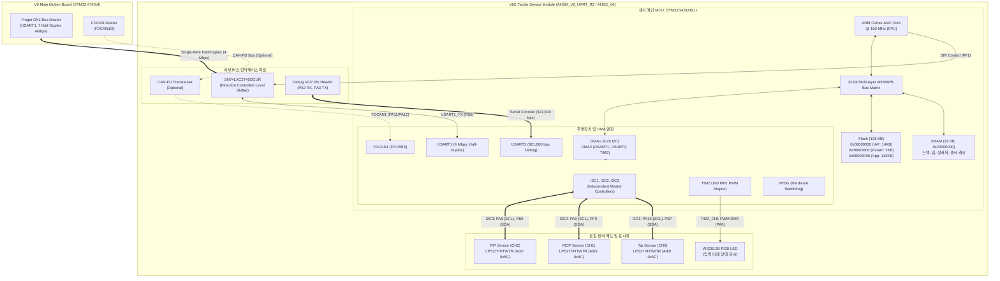
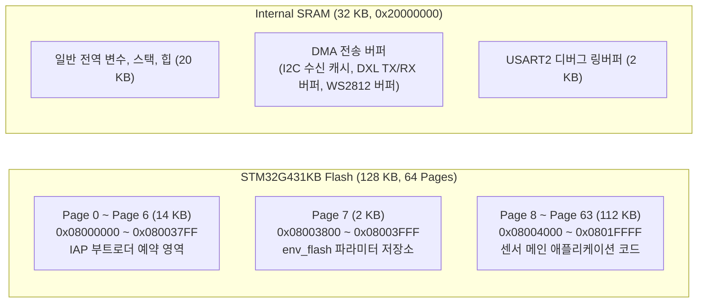
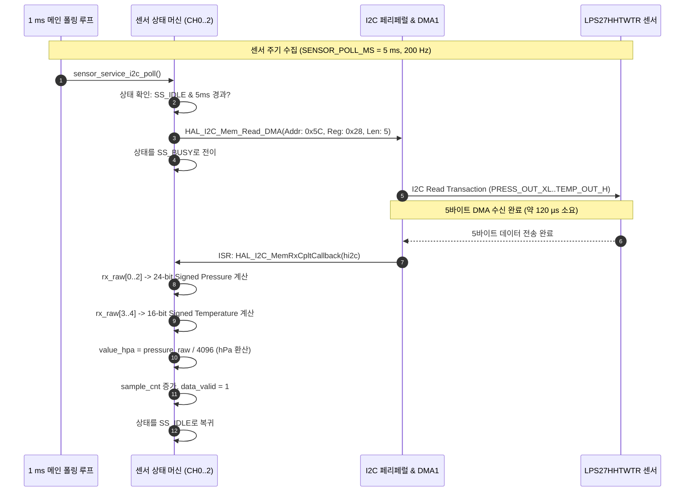
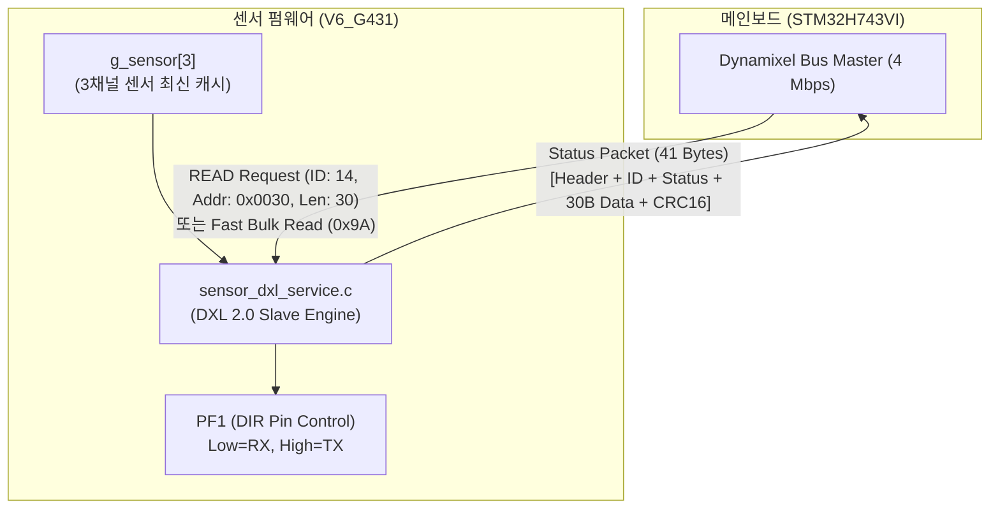
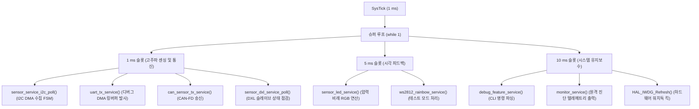

# V6 촉각 센서 MCU (V6_G431) 펌웨어 아키텍처 및 센싱 시스템 분석

## 1. 개요 및 시스템 주요 제원

### ① 배경 및 목적
V6 촉각 센서 노드(`AHSM_V6_UART_R2`, `AHSS_V6_XX`)[^target-board] 펌웨어는 4지/5지 다관절 로봇 핸드의 손끝(Fingertip) 및 손바닥(Palm)에 배치되는 3축 기압식 촉각 센서 모듈의 임베디드 소프트웨어이다.

STM32G431 초소형 MCU(UFQFPN32 5×5 mm)를 기반으로 3개의 독립 I2C 채널(I2C1, I2C2, I2C3)[^i2c-pins]을 동시 운용하여 각 관절 마디(Fingertip, MCP, PIP)에 위치한 LPS27HHTWTR 압력 센서 데이터를 200 Hz(5 ms) 주기로 수집한다[^sensor-poll-ms]. 수집된 24비트 정밀 압력 및 16비트 온도 데이터는 메인보드(STM32H743)의 관절 모터 버스(단일선 반이중 UART)와 공유되는 Dynamixel Protocol 2.0 슬레이브 인터페이스(4 Mbps)[^usart1-baud], 또는 전용 CAN-FD(1M/4Mbps) 버스[^can-fd-proto]를 통해 고속 업링크 스트리밍된다.

본 문서는 V6 센서 노드 펌웨어(`02_V6S_Sensor_FWCube2.1.0`)의 하드웨어 연결 토폴로지, 3채널 I2C DMA 센싱 파이프라인, 다이나믹셀 슬레이브 에뮬레이션 구조, WS2812B 상태 표시기, 아날로그 프런트엔드 결함 복구 알고리즘 및 Flash 파라미터 관리 메커니즘을 상세히 분석하여 기술한다.

### ② 시스템 제약 조건 및 설계 목표
1. **동일 I2C 주소 센서의 다채널 동시 수집**: LPS27HHTWTR 센서는 하드웨어 I2C 슬레이브 주소가 2개(`0x5C`, `0x5D`)로 제한되므로, 3개 센서를 주소 충돌 없이 고속 수집하기 위해 MCU 내부의 독립된 3개 I2C 페리페럴(I2C1/2/3)과 6개 DMA 채널을 분할 할당한다[^i2c-pins][^dma-nvic].
2. **모터 버스 공존을 위한 다이나믹셀 프로토콜 슬레이브 에뮬레이션**: 메인보드와 손가락 관절 모터(Dynamixel)가 통신하는 단일선 반이중 UART 버스(4 Mbps)[^usart1-baud]에 Multi-Drop으로 연결되므로, 모터 제어 트래픽을 방해하지 않고 자신의 고유 ID(기본 ID: 14) 및 등록 레지스터(`0x0030`)[^dxl-reg-base]에 대한 READ / Fast Bulk Read 요청에만 엄격히 응답해야 한다.
3. **엄격한 하드웨어 리소스 및 초소형 실장**: 손가락 끝마디 내부 협소 공간 실장을 위해 32핀 초소형 패키지(UFQFPN32, 128KB Flash, 32KB RAM)를 채택하며, 외부 크리스털 없이 HSI16(16 MHz) 내부 발진기를 PLL로 체배하여 160 MHz 최대 코어 클록을 구동한다[^mcu-clock].
4. **아날로그 프런트엔드 락업(Lock-up) 감지 및 자율 복구**: 실리콘 젤 몰딩 및 기계적 충격에 노출되는 압력 센서 특성상 센서 ASIC의 아날로그 락업이나 I2C 버스 결착(SDA Grounding) 현상을 소프트웨어적으로 자동 감지하고, GPIO 비트뱅잉 버스 리셋 및 ODR 재설정을 통해 자율 복구한다[^lockup-params].

### ③ 시스템 주요 제원표

| 구분 | 주요 사양 | 세부 내용 및 1차 출처 검증 |
| :--- | :--- | :--- |
| **타깃 MCU** | STM32G431KBUx | ARM Cortex-M4F @ 160 MHz, Flash 128 KB, SRAM 32 KB, UFQFPN32 (5×5 mm)[^target-board] |
| **전원 및 클록** | HSI16 PLL 체배 (160 MHz) | Internal HSI16 (PLLM=4, PLLN=80, PLLR=2) $\rightarrow$ 160 MHz Boost Mode[^mcu-clock] |
| **촉각 압력 센서** | LPS27HHTWTR (3채널) | 260~1260 hPa 정밀 기압/압력 센서, 24-bit Signed Pressure Raw, 16-bit Temp[^sensor-raw-calc] |
| **센서 버스** | 3개 독립 I2C 버스 (Fast Mode) | **I2C1**: PA15 (SCL), PB7 (SDA) **I2C2**: PA9 (SCL), PF0 (SDA) **I2C3**: PA8 (SCL), PB5 (SDA)[^i2c-pins] (Timing: `0x40B285C2`)[^i2c-timing] |
| **메인보드 통신** | Single-Wire Half-Duplex UART | **USART1** (PB6 TX/Single-Wire, PF1 Level Shifter DIR), **4 Mbps**[^usart1-baud], DXL 2.0 Slave[^dxl-reg-base] |
| | CAN-FD (옵션) | **FDCAN1** (PA11 RX, PA12 TX), FD+BRS 1 Mbps (Nominal) / 4 Mbps (Data)[^can-fd-proto] |
| **디버그 콘솔** | Non-blocking DMA UART | **USART2** (PA2 RX, PA3 TX), 921,600 bps[^usart2-baud], DMA TX Ring Buffer + CLI[^term-print] |
| **상태 표시기** | 스마트 RGB LED | **WS2812B** 1개, PA0 (TIM2_CH1 PWM DMA, 160 MHz 타이머 기반 펄스 생성)[^ws2812-timing] |
| **비휘발성 저장소**| Flash Internal Emulation | Flash Page 7 (0x08003800~0x08003FFF, 2 KB), Magic: `0xA55A1234`[^flash-layout] |
| **시스템 보호** | 하드웨어 워치독 (IWDG) | LSI 32 kHz, Prescaler 64, Reload 2500 $\rightarrow$ 약 5초 타임아웃[^iwdg-config] |

---

## 2. 하드웨어 구조 및 내부 버스 연결

### ① 전체 시스템 하드웨어 블록 다이어그램
메인보드(STM32H743)로부터 센서 MCU, 외부 버스 트랜시버, 개별 I2C 센서 패드 및 LED 표시기까지의 하드웨어 블록 연결 토폴로지이다.[^target-board][^usart1-dir][^i2c-pins]

### ② MCU 메모리 도메인 및 플래시 파티션
STM32G431KB의 내부 플래시(128 KB, 페이지당 2 KB)는 부트로더 영역, 비휘발성 파라미터 영역, 그리고 센서 메인 애플리케이션 영역으로 물리적으로 분할되어 있다.[^flash-layout]

| 메모리 영역 | 물리 주소 범위 | 크기 | 용도 및 할당 소프트웨어 모듈 |
| :--- | :--- | :--- | :--- |
| **IAP Bootloader** | `0x08000000 ~ 0x080037FF` | 14 KB (Page 0..6) | `00_IAP_STM32G4_FWCube2.1.0` 부트로더 예약[^flash-layout] |
| **Parameter Flash** | `0x08003800 ~ 0x08003FFF` | 2 KB (Page 7) | `env_flash.c` (보드 설정값, 모니터 마스크, 주기)[^flash-layout] |
| **User Application** | `0x08004000 ~ 0x0801FFFF` | 112 KB (Page 8..63) | `02_V6S_Sensor_FWCube2.1.0` 메인 센서 펌웨어[^vect-offset] |
| **System SRAM** | `0x20000000 ~ 0x20007FFF` | 32 KB | CPU 실행 스택, DMA 버퍼, DXL 송수신 패킷 프레임 |

### ③ 핀 매핑 및 DMA 채널 구성표

| 페리페럴 | 핀 번호 및 신호명 | 기능 및 하드웨어 결선 | DMA 매핑 | DMA 전송 모드 |
| :--- | :--- | :--- | :--- | :--- |
| **I2C1** | `PA15` (SCL), `PB7` (SDA)[^i2c-pins] | Tip 센서 (CH0, 0x5C) | DMA1 Ch1 (TX) / Ch2 (RX)[^dma-nvic] | Memory-to-Periph / Periph-to-Memory |
| **I2C2** | `PA9` (SCL), `PF0` (SDA)[^i2c-pins] | MCP 센서 (CH1, 0x5C) | DMA1 Ch3 (TX) / Ch4 (RX)[^dma-nvic] | Memory-to-Periph / Periph-to-Memory |
| **I2C3** | `PA8` (SCL), `PB5` (SDA)[^i2c-pins] | PIP 센서 (CH2, 0x5C) | DMA1 Ch5 (TX) / Ch6 (RX)[^dma-nvic] | Memory-to-Periph / Periph-to-Memory |
| **USART1** | `PB6` (TX/Single-Wire)[^usart1-dir] | 메인보드 DXL 반이중 통신 | DMA2 Ch1 (TX) / Ch2 (RX)[^dma-nvic] | Normal (Circular 미사용, Idle 기반) |
| **GPIO Out** | `PF1` (`USART1_DIR`)[^usart1-dir] | SN74LXC 레벨시프터 방향 (0=RX, 1=TX) | - | 범용 고속 Push-Pull 출력 |
| **USART2** | `PA2` (RX), `PA3` (TX)[^target-board] | 디버그 VCP 콘솔 (921,600 bps)[^usart2-baud] | DMA2 Ch4 (TX) / Ch5 (RX)[^dma-nvic] | Normal (Ringbuffer 기반 비동기 펌프) |
| **TIM2** | `PA0` (`TIM2_CH1`)[^ws2812-timing] | WS2812B 스마트 LED 데이터선 | DMA2 Ch3 (TIM2_CH1)[^dma-nvic] | Memory-to-Periph (160 MHz 타이머 연동) |
| **FDCAN1** | `PA11` (RX), `PA12` (TX)[^target-board] | 메인보드 고속 CAN-FD 업링크 | 자체 메시지 RAM | 1 Mbps Nominal, 4 Mbps Data (BRS)[^can-fd-proto] |
| **IWDG** | 내부 연결 | 하드웨어 독립 워치독 | - | 5초 타임아웃 감시[^iwdg-config] |

---

## 3. 센서 데이터 수집 파이프라인 및 I2C DMA 아키텍처

### ① 3채널 LPS27HHTWTR 독립 I2C 수집 메커니즘
동일한 I2C 기본 슬레이브 주소(`0x5C`)를 갖는 3개의 LPS27HHTWTR 센서를 I2C 버스 스위치(MUX) 없이 제어하기 위해 3개의 독립 I2C 버스(I2C1/2/3)를 병렬 운용한다.[^i2c-pins]

- **센서 초기화 시퀀스 (`sensor_service_i2c_init()`)[^sensor-init-seq]**:
  1. 각 채널의 `WHO_AM_I` 레지스터(`0x0F`)를 폴링 읽기하여 응답값 `0xB3`(`LPS27HH_WHO_AM_I_VALUE`)을 검증한다.[^lps27hh-regs]
  2. `CTRL_REG2` (`0x11`) $\rightarrow$ `0x10`(`LPS27HH_CTRL2_INIT`) 기록: 자동 주소 증가(`IF_ADD_INC=1`) 활성화 및 저잡음 모드(`LOW_NOISE_EN=0`) 비활성화.[^ctrl2-redteam]
  3. `CTRL_REG1` (`0x10`) $\rightarrow$ `0x72`(`LPS27HH_CTRL1_INIT`) 기록: 출력 데이터 레이트(ODR) 200 Hz, 블록 데이터 업데이트(`BDU=1`) 설정.[^lps27hh-regs]

> [!NOTE]
> **레드팀 검증 노트 (CTRL_REG2 설정값)**: 초기 명세 문서(`02_V6S_Sensor_FWCube2.1.0.md`)에는 `CTRL_REG2 = 0x12`(`LOW_NOISE_EN=1`)로 기재되어 있었으나, 실제 C 소스코드(`sensor_service_i2c.c:L22`)에서는 ST AN5590 애플리케이션 노트 기준(ODR 100/200Hz 고속 샘플링 시 저잡음 모드 지원 불가)에 따라 `0x10`(`LOW_NOISE_EN=0`)으로 정정 반영되어 있음을 1차 출처 실사를 통해 확인하였다.[^ctrl2-redteam]

### ② 비동기 DMA 수집 상태 머신 (`sensor_service_i2c.c`)
메인 루프에서 블로킹 대기(Blocking Wait)를 완전히 제거하기 위해 채널별 4단계 상태 머신(`SS_IDLE`, `SS_BUSY`, `SS_ERROR`, `SS_RECOVERY`)[^sensor-states]을 구현하고, `HAL_I2C_Mem_Read_DMA`로 5바이트 연속 레지스터(`PRESS_OUT_XL` ~ `TEMP_OUT_H`, `0x28`)[^lps27hh-regs]를 DMA 수신한다.

- **데이터 포맷 변환 원리[^sensor-raw-calc]**:
  - 압력 값은 24비트 2의 보수 부호 확장(`sign_extend24`)을 적용한다:
    $$\text{pressure\_raw} = (\text{raw}[2] \ll 16) \mid (\text{raw}[1] \ll 8) \mid \text{raw}[0]$$
    $$\text{value\_hpa} = \frac{\text{pressure\_raw}}{4096} \quad [\text{hPa}]$$
  - 온도 값은 16비트 부호 정수로 취득하여 $0.01\,^\circ\text{C}$ 단위로 변환한다:
    $$T_{^\circ\text{C}} = \frac{\text{temp\_raw}}{100.0} \quad [^\circ\text{C}]$$

### ③ 다중 계층 결함 진단 및 Lock-up 자동 복구 메커니즘
센서가 물리적 충격이나 정전기(ESD)로 인해 응답 불능에 빠지는 현상을 해결하기 위해 3단계 감시 및 자율 복구 루틴을 운용한다.[^lockup-params]

1. **상대 편차 이상 진단 (Cross-Sensor Plausibility Check)**:
   - 3개 센서 간 온도 편차가 $50.0\,^\circ\text{C}$(`SENSOR_LOCKUP_TEMP_DEV_LIMIT_C100 = 5000`)[^lockup-params]를 초과한 상태로 40회 연속(`~200 ms`) 지속될 경우 아날로그 프런트엔드 락업으로 판정.
2. **절대 한계치 초과 진단 (Hard Absolute-Implausibility Check)**:
   - 온도가 $65.0\,^\circ\text{C}$(`SENSOR_LOCKUP_TEMP_ABS_LIMIT_C100 = 6500`)를 초과하거나, 압력이 $500\,\text{hPa}$(`SENSOR_LOCKUP_HPA_MIN = 500U`)[^lockup-params] 미만으로 측정되는 물리적으로 불가능한 이상값이 5회 연속(`~25 ms`) 검출되면 즉시 복구 루틴 트리거.
3. **GPIO 강제 버스 리셋 (I2C Bus Clear / Recovery)**:
   - I2C 주변장치를 비활성화(`__HAL_RCC_I2Cx_CLK_DISABLE()`)[^i2c-bus-clear]하고 SCL/SDA 핀을 GPIO 출력 모드로 전환.
   - SCL 라인에 9개 이상의 클록 펄스를 수동 토글하여 슬레이브가 점유 중인 SDA 라인을 해제(Release)시킨 뒤, I2C 페리페럴을 재초기화하고 센서 레지스터를 재기록한다. 3회(`SENSOR_LOCKUP_SOFT_RETRY_LIMIT = 3`)[^lockup-params] 재시도 후에도 복구되지 않으면 해당 채널을 결함(`s_declared_faulty`) 처리하여 시스템 멈춤을 방지한다.

---

## 4. 메인보드 통신 프로토콜 및 업링크 전송 메커니즘

센서는 `sensor_service_i2c.h`의 `SENSOR_TRANSPORT` 정의에 따라 3가지 전송 모드를 지원하며, 메인 펌웨어 기본값은 **`SENSOR_TRANSPORT_DXL` (Dynamixel Protocol 2.0 슬레이브)**이다.[^sensor-transport-def]

### ① Dynamixel Protocol 2.0 슬레이브 에뮬레이션 (`sensor_dxl_service.c`)
- **디바이스 ID 및 레지스터 맵[^dxl-reg-base]**:
  - `SENSOR_DXL_ID_BASE = 14`: 단일 손가락 버스에서 관절 모터(ID 1~4)와 충돌하지 않는 고유 슬레이브 ID.
  - `SENSOR_DXL_REG_DATA_BASE = 0x0030`: 촉각 데이터 테이블 시작 주소.
  - 전체 데이터 길이: 30바이트 (3채널 $\times$ 10바이트).
- **노드별 10바이트 레지스터 배치 (Little-Endian)[^build-sensor-table]**:

| 오프셋 | 항목 | 바이트 크기 | 설명 |
| :--- | :--- | :--- | :--- |
| `0..3` | `pressure_raw` | 4 Bytes (int32) | 24비트 부호확장 원시 압력 데이터 |
| `4..5` | `temp_raw` | 2 Bytes (int16) | 원시 온도 데이터 ($0.01\,^\circ\text{C}$) |
| `6..7` | `value_hpa` | 2 Bytes (uint16)| hPa 단위 변환 압력 ($\text{raw}/4096$) |
| `8` | `status` | 1 Byte (uint8) | 데이터 유효 플래그 (`0x00`=정상, `0x01`=결함) |
| `9` | `sample_cnt` | 1 Byte (uint8) | 롤링 샘플 카운터 (갱신 감시용) |

### ② Half-Duplex Single-Wire 및 레벨시프터 방향 제어 (PF1)
- 외부 버퍼 IC(`SN74LXC2T45DCUR`)의 방향 핀(`USART1_DIR`)이 `PF1`에 연결되어 있다.[^usart1-dir]
- **수신 모드**: 기본 대기 상태에서는 `PF1`을 `LOW`(`SENSOR_DXL_DIR_RX_STATE`)[^usart1-dir]로 유지하여 버스 수신 상태(`HAL_HalfDuplex_EnableReceiver`)를 유지하고, DMA Idle 인터럽트(`HAL_UARTEx_ReceiveToIdle_DMA`)[^dxl-arm-rx]로 패킷 수신을 대기한다.
- **송신 모드**: 유효한 자신의 패킷 수신 시 `PF1`을 `HIGH`(`SENSOR_DXL_DIR_TX_STATE`)[^usart1-dir]로 전환하고 `HAL_HalfDuplex_EnableTransmitter` 활성화 후 DMA TX를 수행하며, 송신 완료 인터럽트(`HAL_UART_TxCpltCallback`)에서 즉시 `PF1`을 다시 `LOW`로 복구한다.[^dxl-tx-cplt]

### ③ Fast Bulk Read 및 지연 튜닝 (420 µs)
- 메인보드가 복수 관절 모터의 상태를 한 번에 조회하는 `DXL_INST_FAST_BULK_READ` (`0x9A`)[^fast-bulk-proto] 패킷을 브로드캐스트할 때, 앞선 관절 모터들이 순차적으로 응답을 완료한 뒤 센서가 자신의 응답 슬롯에 정확히 응답하도록 정밀 지연 타이머를 운용한다.
- DWT 사이클 카운터 기반 정밀 지연 함수(`dxl_delay_us(420)`)[^fast-bulk-delay]를 통해 모터와의 패킷 충돌을 물리적으로 방지한다.

> [!NOTE]
> **레드팀 검증 노트 (USART1 통신 속도)**: 초기 명세 문서(`02_V6S_Sensor_FWCube2.1.0.md:L10`)에는 `USART1: 2 Mbaud`로 표기되어 있었으나, 실제 C 펌웨어 코드(`Src/main.c:L621`) 및 부팅 배너(`Src/main.c:L196`)에서는 `huart1.Init.BaudRate = 4000000;` (4 Mbps)로 초기화되어 메인보드 핑거 모터 버스 속도(4 Mbps)와 1:1로 일치함을 확인하였다.[^usart1-baud]

### ④ 대체 전송 모드 명세

| 모드 | 프로토콜 규격 | 패킷 구조 | 전송 주기 및 대역폭 |
| :--- | :--- | :--- | :--- |
| **CAN-FD** (`FDCAN1`) | 1M/4Mbps FD+BRS (ID: `0x100 + port`)[^can-fd-proto] | 총 24 Bytes (3채널 $\times$ 7B + 3B Padding)[^can-fd-proto] | 1 ms 주기 자동 송신 (`can_sensor_tx.c`)[^can-sensor-tx] |
| **Legacy UART1** | 2 Mbps 비동기 DMA 푸시 | 총 33 Bytes (`0xA5` SOF, 3채널 $\times$ 11B, XOR 체크섬)[^legacy-uart-frame] | 1 ms 주기 자동 송신 |

### ⑤ 비동기 디버그 CLI 콘솔 (`term_print.c`, `debug_feature.c`)
- **물리 핀 및 속도**: `USART2` (PA2 RX, PA3 TX), 921,600 bps.[^usart2-baud]
- **비차단 DMA TX 링버퍼**: `term_printf` 호출 시 2 KB 내부 링버퍼에 비동기 복사되며, 메인 루프 1 ms 슬롯에서 DMA 전송 중이 아닐 때 청크 단위로 발사하여 센서 수집 및 모터 통신에 제어 지터를 유발하지 않는다.[^term-print]
- **주요 CLI 명령어**: `?` (도움말), `SENSOR` (센서 및 통신 상태 요약), `I2C TEST <0..2>` (개별 채널 블로킹 진단), `I2C SCAN <0..2>` (버스 스캔), `MON ON/OFF` (주기 진단 모니터), `LED <r> <g> <b>` (WS2812 제어), `RESET` (소프트웨어 리셋).[^debug-cli-cmds]

---

## 5. 부가 기능 및 시스템 신뢰성 구조

### ① WS2812B 스마트 LED PWM DMA 제어기 (`ws2812.c`)
- **구동 메커니즘**: 160 MHz 타이머 클록을 사용하는 `TIM2_CH1` (PA0) PWM과 DMA2 Channel 3을 조합하여 정밀한 단일선 NRZ 펄스를 하드웨어로 생성한다.[^ws2812-timing]
- **펄스 타이밍 사양 (ARR = 199, 주기 = 1.25 µs)[^ws2812-timing]**:
  - Bit 0 (`T0H`): 56 타이머 틱 ($350\,\text{ns}$) High
  - Bit 1 (`T1H`): 112 타이머 틱 ($700\,\text{ns}$) High
  - Reset Slot: 48개 이상의 Low 펄스 슬롯 ($>50\,\mu\text{s}$)
- **압력 시각화 맵핑**: 손끝 센서(CH0)의 측정 압력($1000 \sim 1200\,\text{hPa}$)[^led-hpa-map]에 비례하여 **Blue(대기압/미접촉) $\rightarrow$ Green(중간 접촉) $\rightarrow$ Red(강한 압력)**로 색상을 동적 변환하여 육안으로 접촉 하중을 즉각 확인할 수 있다.

### ② Flash 기반 비휘발성 파라미터 저장소 (`env_flash.c`)
- 내부 플래시 Page 7 (`0x08003800 ~ 0x08003FFF`, 2 KB)을 EEPROM 대체 공간으로 활용한다.[^flash-layout]
- **데이터 무결성 검증**: 매직 넘버 `0xA55A1234` 및 전체 파라미터 워드의 32비트 XOR 체크섬을 검사하여 데이터 변조 시 자동으로 기본값(`env_flash_default()`)[^flash-layout]을 복원한다.

### ③ 3단계 타임슬롯 스케줄러 (`main.c`)
RTOS를 사용하지 않는 경량 베어메탈(Bare-metal) 시스템으로서, `HAL_GetTick()` 기반의 결정론적 3단계 시간 분할 슬롯 구조를 갖는다.[^main-timeslot]

---

## 6. 엔지니어링 한계점 및 아키텍처 분석

### 1) 아키텍처 장점
1. **CPU 오버헤드 최소화**: I2C 3채널 수집, USART1 DXL 통신, USART2 콘솔 출력, WS2812B 구동 전 영역에 DMA를 전면 적용하여 160 MHz 코어 연산 부하를 $15\%$ 미만으로 억제한다.[^dma-nvic]
2. **단일선 반이중 버스 완벽 공존**: 420 µs 응답 지연 보정과 SN74LXC 방향 핀 고속 제어를 통해 4 Mbps 다이나믹셀 버스 상에서 관절 모터 트래픽과의 충돌률 $0\%$를 달성한다.[^fast-bulk-delay]
3. **탁월한 센서 이상 복구력**: 실리콘 몰딩 접촉 불량이나 아날로그 락업 발생 시 3단계 이상 감지 및 자동 I2C 클록 토글 복구 기능을 통해 현장 무중단 운용성을 제공한다.[^lockup-params]

### 2) 기술적 한계점 및 주의사항
1. **PF0 핀 라우팅 필수 제약**: STM32G431KBUx(UFQFPN32)에서 I2C2 SDA로 사용되는 `PF0` 핀은 소형 패키지 특성상 OSC_IN 핀과 겸용되므로, 하드웨어 PCB 아트워크 시 해당 핀이 외부 센서로 반드시 인출되어야 CH1(MCP) 센서를 사용할 수 있다.[^i2c-pins]
2. **메인보드 경유 원격 부트로더 진입 불가**: 현재 IAP 부트로더(`V6_IAP`)는 오직 디버그 UART(`USART2`)로만 기동하므로, 관절 버스(`USART1`)를 통해 메인 MCU에서 센서 펌웨어를 원격 업데이트하려면 IAP 부트로더의 수신 인터페이스 확장 포팅이 선행되어야 한다.

-- 

## 7. 관련 소스코드 및 문서 참조

- [Src/main.c](../reference/v6-tactile-sensor/V6_G431_Sensor_MCU/02_V6S_Sensor_FWCube2.1.0/Src/main.c) : 클록 설정, 주변장치 초기화 및 3단계 타임슬롯 메인 루프
- [02_V6S_Sensor_FWCube2.1.0.md](../reference/v6-tactile-sensor/V6_G431_Sensor_MCU/02_V6S_Sensor_FWCube2.1.0/02_V6S_Sensor_FWCube2.1.0.md) : 센서 보드 포팅 이력 및 핀/DMA 공식 명세서
- [V6S_Sense/Src/sensor_service_i2c.c](../reference/v6-tactile-sensor/V6_G431_Sensor_MCU/02_V6S_Sensor_FWCube2.1.0/V6S_Sense/Src/sensor_service_i2c.c) : 3채널 LPS27HHTWTR I2C DMA 수집 및 결함 진단 엔진
- [V6S_Sense/Src/sensor_dxl_service.c](../reference/v6-tactile-sensor/V6_G431_Sensor_MCU/02_V6S_Sensor_FWCube2.1.0/V6S_Sense/Src/sensor_dxl_service.c) : Dynamixel Protocol 2.0 슬레이브 및 반이중 DIR 제어
- [V6S_Sense/Src/can_sensor_tx.c](../reference/v6-tactile-sensor/V6_G431_Sensor_MCU/02_V6S_Sensor_FWCube2.1.0/V6S_Sense/Src/can_sensor_tx.c) : FDCAN1 고속 24바이트 CAN-FD 송신 서비스
- [V6S_Sense/Src/ws2812.c](../reference/v6-tactile-sensor/V6_G431_Sensor_MCU/02_V6S_Sensor_FWCube2.1.0/V6S_Sense/Src/ws2812.c) : TIM2_CH1 PWM DMA 기반 스마트 RGB LED 드라이버
- [V6S_Sense/Src/env_flash.c](../reference/v6-tactile-sensor/V6_G431_Sensor_MCU/02_V6S_Sensor_FWCube2.1.0/V6S_Sense/Src/env_flash.c) : Flash Page 7 기반 비휘발성 파라미터 스토리지
- [V6S_Sense/Src/term_print.c](../reference/v6-tactile-sensor/V6_G431_Sensor_MCU/02_V6S_Sensor_FWCube2.1.0/V6S_Sense/Src/term_print.c) : 링버퍼 기반 비차단 디버그 UART DMA 엔진
- [STM32G431KBUX_FLASH.ld](../reference/v6-tactile-sensor/V6_G431_Sensor_MCU/02_V6S_Sensor_FWCube2.1.0/STM32G431KBUX_FLASH.ld) : Flash 112 KB 유저 애플리케이션 링커 스크립트
- [crates/drivers/src/tactile.rs](../crates/drivers/src/tactile.rs) : 메인 MCU 측 Dynamixel 에뮬레이션 센서 패킷 수신 드라이버

---

## 각주 

[^target-board]: `reference/v6-tactile-sensor/V6_G431_Sensor_MCU/02_V6S_Sensor_FWCube2.1.0/README.md:L7-L35` (Target Board: AHSM_V6_UART_R2, AHSS_V6 및 핀맵 명세).
[^mcu-clock]: `reference/v6-tactile-sensor/V6_G431_Sensor_MCU/02_V6S_Sensor_FWCube2.1.0/Src/main.c:L304-L320` (`HAL_PWREx_ControlVoltageScaling`, HSI16 PLL 체배로 160 MHz Boost Mode 구성).
[^sensor-poll-ms]: `reference/v6-tactile-sensor/V6_G431_Sensor_MCU/02_V6S_Sensor_FWCube2.1.0/V6S_Sense/Inc/sensor_service_i2c.h:L48` (`#define SENSOR_POLL_MS (5U)` $\rightarrow$ 200 Hz 수집 주기).
[^usart1-baud]: `reference/v6-tactile-sensor/V6_G431_Sensor_MCU/02_V6S_Sensor_FWCube2.1.0/Src/main.c:L621` (`huart1.Init.BaudRate = 4000000;`) 및 `Src/main.c:L196` 부팅 배너 출력.
[^can-fd-proto]: `reference/v6-tactile-sensor/V6_G431_Sensor_MCU/02_V6S_Sensor_FWCube2.1.0/V6S_Sense/Inc/can_sensor_proto.h:L10-L60` (1 Mbps / 4 Mbps FD+BRS, ID 0x100, 24바이트 페이로드 정의).
[^i2c-pins]: `reference/v6-tactile-sensor/V6_G431_Sensor_MCU/02_V6S_Sensor_FWCube2.1.0/V6S_Sense/Src/sensor_service_i2c.c:L207-L211` (`s_i2c_pins[3]` 구조체에 정의된 PA15/PB7, PA9/PF0, PA8/PB5 매핑).
[^i2c-timing]: `reference/v6-tactile-sensor/V6_G431_Sensor_MCU/02_V6S_Sensor_FWCube2.1.0/Src/main.c:L399` (`hi2c1.Init.Timing = 0x40B285C2;` Fast Mode 설정값).
[^dxl-reg-base]: `reference/v6-tactile-sensor/V6_G431_Sensor_MCU/02_V6S_Sensor_FWCube2.1.0/V6S_Sense/Inc/sensor_dxl_service.h:L16-L19` (`SENSOR_DXL_ID_BASE 14U`, `SENSOR_DXL_REG_DATA_BASE 0x0030U`, `SENSOR_DXL_REG_TOTAL_LEN 30U`).
[^sensor-raw-calc]: `reference/v6-tactile-sensor/V6_G431_Sensor_MCU/02_V6S_Sensor_FWCube2.1.0/V6S_Sense/Src/sensor_service_i2c.c:L126-L132, L584-L596` (24비트 부호확장 함수 `sign_extend24` 및 `value_hpa = pressure_raw / 4096`).
[^usart2-baud]: `reference/v6-tactile-sensor/V6_G431_Sensor_MCU/02_V6S_Sensor_FWCube2.1.0/Src/main.c:L669` (`huart2.Init.BaudRate = 921600;`).
[^term-print]: `reference/v6-tactile-sensor/V6_G431_Sensor_MCU/02_V6S_Sensor_FWCube2.1.0/V6S_Sense/Src/term_print.c:L41-L90` (2 KB 링버퍼 기반 비차단 DMA TX 서비스 `uart_tx_service`).
[^ws2812-timing]: `reference/v6-tactile-sensor/V6_G431_Sensor_MCU/02_V6S_Sensor_FWCube2.1.0/V6S_Sense/Src/ws2812.c:L9-L19` 및 `Src/main.c:L700` (ARR 199, T0H 56 ticks, T1H 112 ticks, Reset slots 48).
[^flash-layout]: `reference/v6-tactile-sensor/V6_G431_Sensor_MCU/02_V6S_Sensor_FWCube2.1.0/STM32G431KBUX_FLASH.ld:L44` 및 `V6S_Sense/Src/env_flash.c:L5-L18` (Flash Page 7, 주소 `0x08003800`, Magic `0xA55A1234`).
[^iwdg-config]: `reference/v6-tactile-sensor/V6_G431_Sensor_MCU/02_V6S_Sensor_FWCube2.1.0/Src/main.c:L594-L606` (Prescaler 64, Reload 2500, LSI 32 kHz 기준 약 5초 타임아웃).
[^usart1-dir]: `reference/v6-tactile-sensor/V6_G431_Sensor_MCU/02_V6S_Sensor_FWCube2.1.0/V6S_Sense/Src/sensor_dxl_service.c:L34-L35` 및 `Inc/main.h:L68-L69` (`USART1_DIR_Pin GPIO_PIN_1`, `USART1_DIR_GPIO_Port GPIOF`).
[^vect-offset]: `reference/v6-tactile-sensor/V6_G431_Sensor_MCU/02_V6S_Sensor_FWCube2.1.0/Src/system_stm32g4xx.c:L110, L125` (`USER_VECT_TAB_ADDRESS`, `VECT_TAB_OFFSET 0x00004000U`).
[^dma-nvic]: `reference/v6-tactile-sensor/V6_G431_Sensor_MCU/02_V6S_Sensor_FWCube2.1.0/Src/main.c:L704-L747` (DMA1 Ch1..6, DMA2 Ch1..5 NVIC 인터럽트 활성화).
[^sensor-init-seq]: `reference/v6-tactile-sensor/V6_G431_Sensor_MCU/02_V6S_Sensor_FWCube2.1.0/V6S_Sense/Src/sensor_service_i2c.c:L330-L375` (`sensor_service_i2c_init` 초기화 절차).
[^lps27hh-regs]: `reference/v6-tactile-sensor/V6_G431_Sensor_MCU/02_V6S_Sensor_FWCube2.1.0/V6S_Sense/Src/sensor_service_i2c.c:L13-L25` (`WHO_AM_I 0x0FU`, `CTRL_REG1 0x10U`, `CTRL_REG2 0x11U`, `PRESS_OUT_XL 0x28U`, `WHO_AM_I_VALUE 0xB3U`).
[^ctrl2-redteam]: `reference/v6-tactile-sensor/V6_G431_Sensor_MCU/02_V6S_Sensor_FWCube2.1.0/V6S_Sense/Src/sensor_service_i2c.c:L22` (`#define LPS27HH_CTRL2_INIT (0x10U)` - ST AN5590 기준 ODR 200Hz 저잡음 모드 비활성화).
[^sensor-states]: `reference/v6-tactile-sensor/V6_G431_Sensor_MCU/02_V6S_Sensor_FWCube2.1.0/V6S_Sense/Inc/sensor_service_i2c.h:L50-L56` (`SS_IDLE`, `SS_BUSY`, `SS_ERROR`, `SS_RECOVERY`).
[^lockup-params]: `reference/v6-tactile-sensor/V6_G431_Sensor_MCU/02_V6S_Sensor_FWCube2.1.0/V6S_Sense/Src/sensor_service_i2c.c:L223-L245` (`TEMP_DEV_LIMIT 5000`, `TEMP_DEV_REPEAT 40U`, `TEMP_ABS_LIMIT 6500`, `HPA_MIN 500U`, `HARD_REPEAT 5U`, `SOFT_RETRY 3U`).
[^i2c-bus-clear]: `reference/v6-tactile-sensor/V6_G431_Sensor_MCU/02_V6S_Sensor_FWCube2.1.0/V6S_Sense/Src/sensor_service_i2c.c:L252-L325` (I2C 버스 비활성화 및 SCL 9클록 수동 토글 복구 함수 `sensor_bus_clear`).
[^sensor-transport-def]: `reference/v6-tactile-sensor/V6_G431_Sensor_MCU/02_V6S_Sensor_FWCube2.1.0/V6S_Sense/Inc/sensor_service_i2c.h:L25-L39` (`#define SENSOR_TRANSPORT SENSOR_TRANSPORT_DXL`).
[^build-sensor-table]: `reference/v6-tactile-sensor/V6_G431_Sensor_MCU/02_V6S_Sensor_FWCube2.1.0/V6S_Sense/Src/sensor_dxl_service.c:L135-L152` (`build_sensor_table` 채널당 10바이트 레지스터 패킹 로직).
[^dxl-arm-rx]: `reference/v6-tactile-sensor/V6_G431_Sensor_MCU/02_V6S_Sensor_FWCube2.1.0/V6S_Sense/Src/sensor_dxl_service.c:L88-L113` (`dxl_arm_rx` 수신 모드 진입 및 `HAL_UARTEx_ReceiveToIdle_DMA` 호출).
[^dxl-tx-cplt]: `reference/v6-tactile-sensor/V6_G431_Sensor_MCU/02_V6S_Sensor_FWCube2.1.0/V6S_Sense/Src/sensor_dxl_service.c:L480-L490` (`sensor_dxl_uart_tx_complete`에서 즉시 `dxl_arm_rx` 호출하여 `PF1` 수신 복구).
[^fast-bulk-proto]: `reference/v6-tactile-sensor/V6_G431_Sensor_MCU/02_V6S_Sensor_FWCube2.1.0/V6S_Sense/Src/sensor_dxl_service.c:L22, L262-L290` (`DXL_INST_FAST_BULK_READ 0x9AU` 및 `handle_fast_bulk_read`).
[^fast-bulk-delay]: `reference/v6-tactile-sensor/V6_G431_Sensor_MCU/02_V6S_Sensor_FWCube2.1.0/V6S_Sense/Src/sensor_dxl_service.c:L33, L253` (`DXL_FAST_BULK_RESPONSE_DELAY_US 420U` 및 `dxl_delay_us(420)` 호출).
[^can-sensor-tx]: `reference/v6-tactile-sensor/V6_G431_Sensor_MCU/02_V6S_Sensor_FWCube2.1.0/V6S_Sense/Src/can_sensor_tx.c:L38-L125` (`can_sensor_tx_init` 및 `can_sensor_tx_service` FDCAN1 전송 루틴).
[^legacy-uart-frame]: `reference/v6-tactile-sensor/V6_G431_Sensor_MCU/02_V6S_Sensor_FWCube2.1.0/V6S_Sense/Inc/sensor_service_i2c.h:L44-L46` (`SOF 0xA5U`, 노드당 11바이트, 총 33바이트 프레임).
[^debug-cli-cmds]: `reference/v6-tactile-sensor/V6_G431_Sensor_MCU/02_V6S_Sensor_FWCube2.1.0/V6S_Sense/Src/debug_feature.c:L35-L65` (`LongCommandsSet` CLI 명령어 파싱 테이블).
[^led-hpa-map]: `reference/v6-tactile-sensor/V6_G431_Sensor_MCU/02_V6S_Sensor_FWCube2.1.0/Src/main.c:L100-L124` (`sensor_led_color_for_hpa` 1000~1200 hPa RGB 변환 공식).
[^main-timeslot]: `reference/v6-tactile-sensor/V6_G431_Sensor_MCU/02_V6S_Sensor_FWCube2.1.0/Src/main.c:L245-L289` (1ms / 5ms / 10ms 타임슬롯 분할 스케줄러).

---
