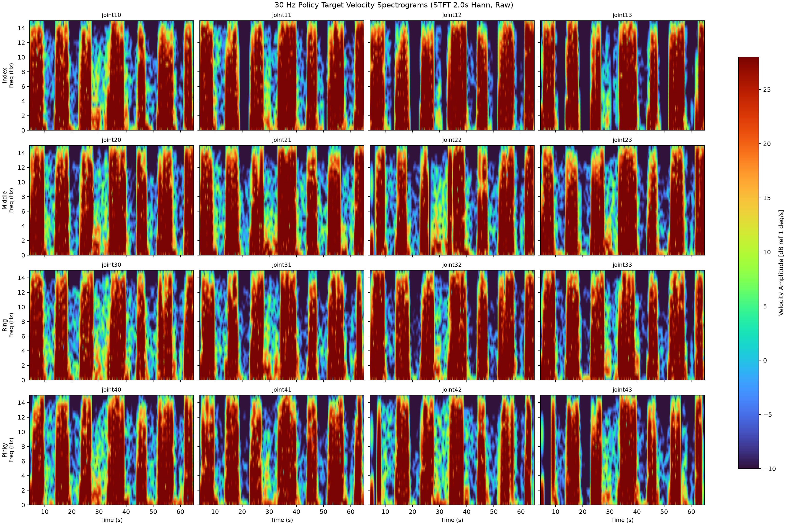
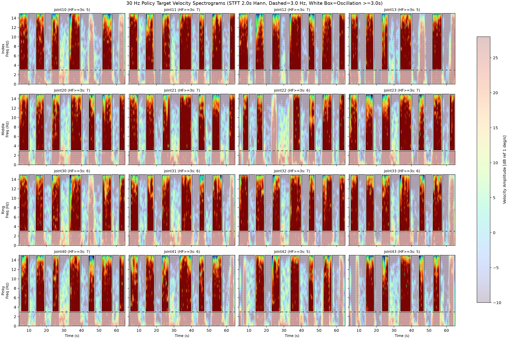
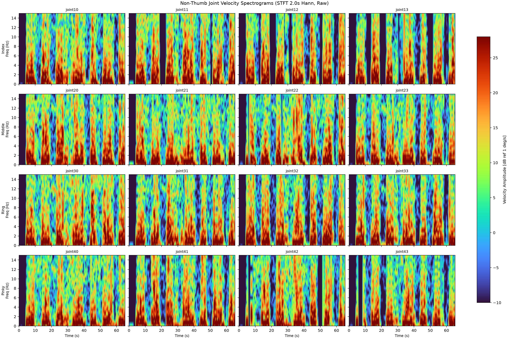
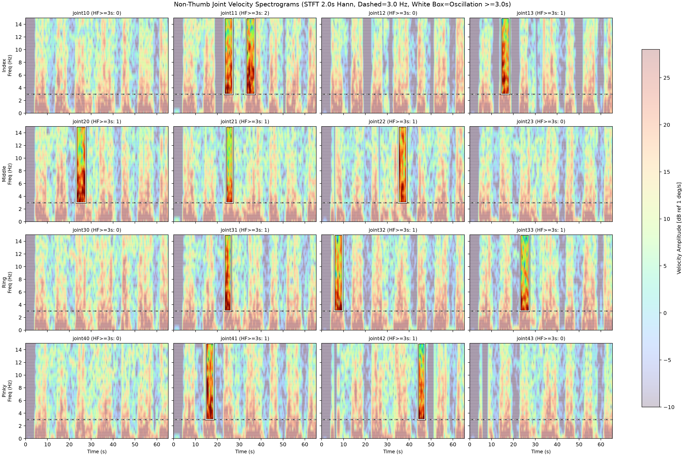

# `2026-11-18_13-33-46` `_policy.csv` 및 `_cmd.csv` 고주파 진동 교차 분석 보고서

## 1. 분석 배경 및 목적

- `2026-11-18_13-33-46_record/` 로그 세트는 30 Hz 정책 네트워크 출력(`_policy.csv`의 `target_<joint>`)을 `Command` 파이프라인(EMA $\alpha=0.5$, 속도 제한 `0.012 rad/tick`, 관절 `clamp` `±0.145 rad`)으로 100 Hz 후처리하여 실제 손에 전송한 명령(`_cmd.csv`)을 함께 기록한다.
- 본 보고서는 **고주파 진동이 `Command`의 EMA 후처리 과정에서 발생한 것인지, 아니면 30 Hz 정책 출력 자체에 이미 내재되어 있는지**를 규명하기 위해 두 데이터를 동일 조건으로 교차 분석한다.

| 대상 파일 | 주기 | 분석 대상 | 샘플 수 / 시간 범위 |
| :--- | :---: | :--- | :--- |
| `2026-11-18_13-33-46_policy.csv` | `30 Hz` | EMA 적용 전 `target_joint10..43` (16관절, PCHIP `30.0 Hz` 등간격 리샘플링) | `1,812`행 (`1,814` 리샘플링, `4.36s ~ 64.80s`) |
| `2026-11-18_13-33-46_cmd.csv` | `100 Hz` | 후처리 후 `/joint_cmd` `joint10..43` (16관절) | `6,522`행 (`0.01s ~ 65.22s`) |

- **검출 기준**: `3.0 Hz` 4차 Butterworth 영위상 고역통과 필터(`sosfiltfilt`) 통과 후 **1초 이동 RMS가 `0.5°` 이상인 상태가 `3.0초` 이상 연속 유지되는 구간**을 검출한다.

---

## 2. 주파수 대역별 평균 에너지 교차 비교 (`Welch PSD`)

4지(엄지 제외) 16개 관절의 평균 대역 파워(`deg²`)를 비교한 결과는 다음과 같다:

| 주파수 대역 | `_policy.csv` (EMA 전, 30 Hz) | `_cmd.csv` (EMA 후, 100 Hz) | `Command` 통과 후 감쇠율 |
| :--- | ---: | ---: | ---: |
| `[0, 1) Hz` | `205.2176` | `135.6037` | `-33.9%` |
| `[1, 2) Hz` | `37.4882` | `3.2764` | `-91.3%` |
| `[2, 3) Hz` | `10.5931` | `0.4065` | `-96.2%` |
| **`[3, 5) Hz`** | **`9.4604`** | **`0.1789`** | **`-98.1%`** |
| **`[5, 10) Hz`** | **`8.5177`** | **`0.0590`** | **`-99.3%`** |
| **`[10, 15) Hz`** | **`4.2697`** | `0.0116` (`10~25 Hz`) | **`-99.7%`** |

- `_policy.csv` 단계에서 이미 `3~15 Hz` 대역 파워 합이 **`22.25 deg²`**(실효 진폭 약 `4.72°` RMS)에 달한다.
- `Command` 파이프라인을 통과하면서 `[3, 5) Hz`는 **98.1%**, `[5, 10) Hz`는 **99.3%** 감쇠된다.

---

## 3. 스펙트로그램 비교 (`0~15 Hz`, 각속도 `deg/s` 기준)

### ① 30 Hz 정책 원시 출력 (`_policy.csv`, EMA·속도제한 전)

### ② 100 Hz 최종 명령 (`_cmd.csv`, EMA·속도제한 후)

- 손가락별 100 Hz 명령 상세 스펙트로그램:
  - [검지(Index) 원본](spectrogram_raw_index.png) / [강조](spectrogram_index.png)
  - [중지(Middle) 원본](spectrogram_raw_middle.png) / [강조](spectrogram_middle.png)
  - [약지(Ring) 원본](spectrogram_raw_ring.png) / [강조](spectrogram_ring.png)
  - [소지(Pinky) 원본](spectrogram_raw_pinky.png) / [강조](spectrogram_pinky.png)

---

## 4. 관절별 고주파 진동(`>= 3.0 Hz`) 정량 교차 비교

| 관절 | `_policy.csv` `>=3Hz` RMS / 피크 | `_policy` 검출 | `_cmd.csv` `>=3Hz` RMS / 피크 | `_cmd` 검출 | RMS 감쇠율 |
| :--- | :---: | :---: | :---: | :---: | :---: |
| `joint10` | `4.028°` / `36.24°` | `5`건 | `0.422°` / `3.38°` | `0`건 | `-89.5%` |
| `joint11` | `5.772°` / `44.96°` | `7`건 | `0.525°` / `3.43°` | `2`건 | `-90.9%` |
| `joint12` | `5.182°` / `44.70°` | `7`건 | `0.452°` / `3.25°` | `0`건 | `-91.3%` |
| `joint13` | `4.881°` / `37.71°` | `5`건 | `0.435°` / `3.50°` | `1`건 | `-91.1%` |
| `joint20` | `5.311°` / `47.02°` | `7`건 | `0.507°` / `3.60°` | `1`건 | `-90.5%` |
| `joint21` | `5.005°` / `43.64°` | `7`건 | `0.392°` / `3.29°` | `1`건 | `-92.2%` |
| `joint22` | `5.042°` / `46.61°` | `6`건 | `0.446°` / `3.40°` | `1`건 | `-91.2%` |
| `joint23` | `4.548°` / `41.63°` | `7`건 | `0.369°` / `2.98°` | `0`건 | `-91.9%` |
| `joint30` | `3.845°` / `26.31°` | `6`건 | `0.492°` / `3.34°` | `0`건 | `-87.2%` |
| `joint31` | `4.526°` / `30.30°` | `6`건 | `0.434°` / `3.62°` | `1`건 | `-90.4%` |
| `joint32` | `5.629°` / `41.16°` | `7`건 | `0.491°` / `3.48°` | `1`건 | `-91.3%` |
| `joint33` | `4.780°` / `36.82°` | `6`건 | `0.464°` / `3.44°` | `1`건 | `-90.3%` |
| `joint40` | `4.092°` / `38.31°` | `7`건 | `0.387°` / `3.38°` | `0`건 | `-90.5%` |
| `joint41` | `4.450°` / `33.76°` | `6`건 | `0.515°` / `3.78°` | `1`건 | `-88.4%` |
| `joint42` | `4.129°` / `34.64°` | `5`건 | `0.433°` / `3.23°` | `1`건 | `-89.5%` |
| `joint43` | `3.834°` / `36.93°` | `5`건 | `0.347°` / `3.57°` | `0`건 | `-90.9%` |
| **합계** | **`3.83° ~ 5.77°`** | **`16/16` 관절, `99`건** | **`0.35° ~ 0.53°`** | **`10/16` 관절, `11`건** | **`-87.2% ~ -92.2%`** |

### `_cmd.csv` 잔존 고주파 진동 구간 상세 (11건)

| 관절 | 검출 구간 (`start ~ end`, 지속시간) | 구간 피크 RMS (`deg`) | 주 주파수 (`Hz`) |
| :--- | :--- | :---: | :---: |
| `joint11` | `23.25 ~ 27.06s` (`3.81s`) | `1.070°` | `4.0 Hz` |
| `joint11` | `33.13 ~ 37.23s` (`4.10s`) | `1.385°` | `4.5 Hz` |
| `joint13` | `14.39 ~ 18.10s` (`3.71s`) | `1.197°` | `5.5 Hz` |
| `joint20` | `23.18 ~ 27.57s` (`4.39s`) | `1.192°` | `4.5 Hz` |
| `joint21` | `23.92 ~ 27.18s` (`3.26s`) | `0.733°` | `3.0 Hz` |
| `joint22` | `35.12 ~ 38.85s` (`3.73s`) | `1.114°` | `4.0 Hz` |
| `joint31` | `23.27 ~ 26.27s` (`3.00s`) | `1.300°` | `4.0 Hz` |
| `joint32` | `5.81 ~ 9.49s` (`3.68s`) | `1.170°` | `3.5 Hz` |
| `joint33` | `23.01 ~ 27.23s` (`4.22s`) | `0.935°` | `3.5 Hz` |
| `joint41` | `14.81 ~ 18.30s` (`3.49s`) | `1.313°` | `4.5 Hz` |
| `joint42` | `44.01 ~ 47.23s` (`3.22s`) | `1.024°` | `3.0 Hz` |

---

## 5. 결론

1. **진동의 원인은 EMA가 아니라 30 Hz 정책 출력(`_policy.csv`)이다**:
   - EMA 적용 전인 `_policy.csv`의 `target`은 `16/16` 전 관절에서 `>= 3.0 Hz` 성분이 `3.83° ~ 5.77°` RMS(최대 순간 진폭 `47.02°`), 3초 이상 지속 구간 **총 `99`건**으로 극심하게 진동한다.
   - `Command`의 EMA($\alpha=0.5$) 및 속도 제한(`0.012 rad/tick`)은 진동을 유발하는 요소가 아니라, 오히려 이 고주파 진동 RMS를 **약 `87~92%` 감쇠**시키는 저역통과 필터 역할을 수행한다.
2. **잔존 진동 발생 메커니즘**:
   - `Command`가 30 Hz 정책의 고주파 진동을 대부분 억제하지만, `14.4 ~ 18.3s`, `23.0 ~ 27.6s`, `33.1 ~ 38.9s`처럼 원시 정책 진폭이 큰 구간에서는 감쇠 후에도 `0.73° ~ 1.39°` RMS(`3.0 ~ 5.5 Hz`) 성분이 `_cmd.csv`에 잔존한다.

---

## 6. 관련 산출물 및 소스코드 참조

- [2026-11-18_13-33-46_policy.csv](2026-11-18_13-33-46_policy.csv) : 30 Hz 정책 출력 로그
- [2026-11-18_13-33-46_cmd.csv](2026-11-18_13-33-46_cmd.csv) : 100 Hz `/joint_cmd` 로그
- [analyze_policy_spectrogram.py](analyze_policy_spectrogram.py) : 30 Hz `_policy.csv` 스펙트로그램 및 진동 검출 스크립트
- [analyze_trajectory_spectrogram.py](../analyze_trajectory_spectrogram.py) : 100 Hz `_cmd.csv` 스펙트로그램 및 진동 검출 스크립트
- [policy_spectrogram_summary.json](policy_spectrogram_summary.json) : `_policy.csv` 정량 요약 JSON
- [spectrogram_summary.json](spectrogram_summary.json) : `_cmd.csv` 정량 요약 JSON
- [LOGS.md](LOGS.md) : 실행 기록 CSV 구조 명세
